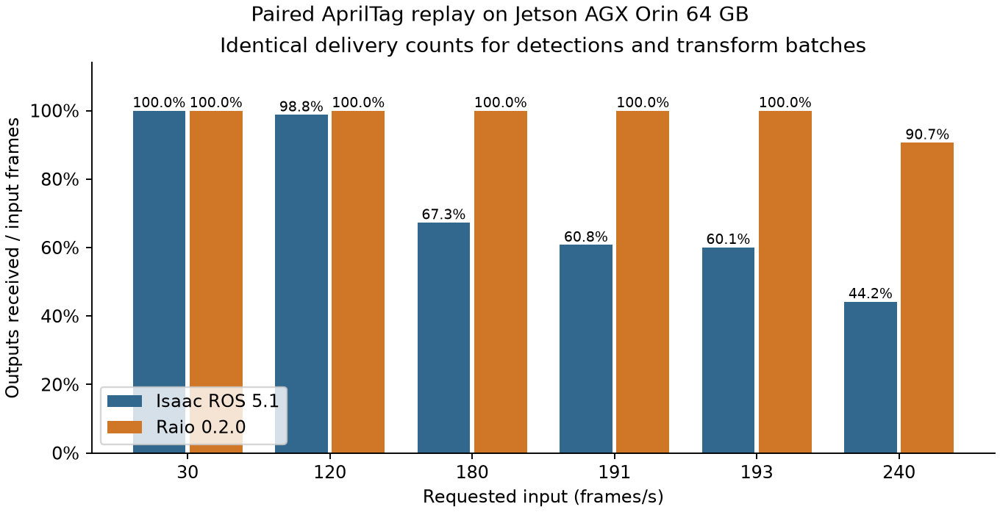

# Native Raio and Isaac ROS AprilTag on A40 and Jetson AGX Orin

The original run compares the published Isaac ROS 4.6 AprilTag graph with a native Raio detection path on the same GPU. The 5.1 repeat uses the Lyrical graph and rebuilds the Raio detector against its CUDA archive. NVIDIA's source graph resizes a slice of the r2b_storage recording, buffers ten HD frames, publishes images and calibration, runs cuAprilTags, and monitors AprilTagDetectionArray. The Raio implementation uses the same static CUDA archive included with the installed NITROS package. Its own detector library links CUDA and the C++ runtime. The detector backend, intrinsics, 0.22 m tag size, tile size 4, tag36h11 family and maximum of 64 detections match the stock node.

## Measured work

A separate observer captures the ten preprocessed frames, calibration messages and per-frame ROS detections in each stock launch. The controller captures them before timing on 4.6 and after timing on 5.1. The observer has no image subscription during the 5.1 timed blocks. The Raio launcher checks each image digest and preloads the immutable images into GPU memory. Its source publishes a CUDA IPC frame descriptor and a separate timestamped calibration value on native ports. The native detector reads matching values at the same logical time. It opens the GPU allocation once, uses the source's image pitch and intrinsics, synchronizes CUDA and publishes detections and transforms on two ports. Separate Raio processes receive the two outputs. The exporting process retains ownership until every child exits. Recorded data and static calibration are specific to this bounded playback test.

Both variants run one warm-up block followed by three measured five-second blocks at each target rate. Each retained ROS block uses the stock C++ composable graph, NITROS image delivery, stock playback and stock detection monitor. The controller exports timestamps *after* monitoring stops. For the historical A40 tables, the stock clock starts after publishing the image and calibration group. The Raio clock starts after setting those two ports, before Raio flushes them to the downstream process at the end of its logical step. End time is monitor receipt. This measures the two implemented detection paths including their runtime overhead. Both detectors publish one detection array and one transform batch per image. Both graphs have separate detection and transform consumers. The latency endpoint is the detection consumer. ROS bag IO, image resizing, GPU preload and initialization are outside the measured interval. A playback target of 240 Hz requests 240 images per second from the ten-frame replay buffer.

The analysis checks every native output against the stock result for the same input stamp. Tolerances are 0.05 px maximum corner-coordinate difference, 1 mm translation norm and 0.1 degrees rotation difference using the absolute quaternion dot product. The fixture contains moving views of a single detected tag. The reported p95 is nearest rank within each retained block, then the median across blocks. The stock monitor uses independent sequence counters by default. Received and sent timestamps are paired in order only in complete blocks. Any loss suppresses the across-block p95 for that runtime/rate. Report counts and achieved rates even when latency cannot be paired. This fixed-rate test does not establish maximum sustainable throughput or live-camera latency.

## A40 replay results with Isaac ROS 4.6

Both detection and transform listeners were active. At each rate, both listeners in a given runtime received the same number of messages. Each delivery column therefore gives the count for one stream. P95 measures playback to detection receipt. A dash indicates that missing detections prevented reliable latency pairing.

| Target fps | Isaac ROS p95 (ms) | Raio p95 (ms) | Isaac ROS delivered | Raio delivered | Inputs |
|---:|---:|---:|---:|---:|---:|
| 30 | 7.86 | 3.43 | 450 | 450 | 450 |
| 60 | 5.29 | 3.18 | 900 | 900 | 900 |
| 120 | 6.58 | 3.29 | 1,800 | 1,800 | 1,800 |
| 180 | — | 2.98 | 2,695 | 2,700 | 2,700 |
| 240 | — | 3.29 | 2,346 | 3,600 | 3,600 |

The ten recorded frames repeat their original camera timestamps. Raio playback sets the image and its calibration in the same logical step. The stock detector matches the streams by timestamp on receipt. This comparison includes those input-handling choices.

## A40 repeat with Isaac ROS 5.1

Raio 0.2.0 and the stock ROS 2 Lyrical graph replayed ten 1280 × 720 images and their matching calibration. Each runtime published detections and transforms. In each measured block the detection and transform receivers recorded the same count. The tag IDs, corners and translations matched the ROS fixture. The maximum orientation difference was 0.000002 degrees. The 4.6 and 5.1 fixtures contained the same ten image digests at all five rates. The observer recorded three of those frames in a different order in the 180 fps fixture.

| Target fps | Isaac ROS 5.1 p95 (ms) | Raio p95 (ms) | Isaac ROS delivered | Raio delivered | Inputs |
|---:|---:|---:|---:|---:|---:|
| 30 | 7.66 | 3.33 | 450 | 450 | 450 |
| 60 | 4.86 | 3.18 | 900 | 900 | 900 |
| 120 | 5.28 | 3.26 | 1,800 | 1,800 | 1,800 |
| 180 | — | 3.16 | 2,697 | 2,700 | 2,700 |
| 240 | — | 3.00 | 2,597 | 3,600 | 3,600 |

At the 240 fps target, ROS offered 238.85, 240.06 and 234.99 fps in its three measured blocks. The third fell outside the controller's 1% target tolerance. The median delivered rates were 170.81 fps for ROS and 239.98 fps for Raio. ROS 4.6 delivered 2,346 of 3,600 in the earlier trial. These are separate benchmark sessions with different ROS playback implementations. A 30 fps control using the untouched 5.1 script also delivered all 450 measured detections. [A40 per-block measurements](../results/isaac_apriltag/a40-51-blocks.csv)

## Transport and secondary outputs

All timed components run on one machine. Raio runs the publisher, detector and monitor in separate processes. Native port values travel over TCP loopback, including the image descriptor, calibration and detections. On A40 a CUDA IPC handle gives the detector access to the resident GPU pixels. On Orin the source shares a CUDA virtual-memory allocation using a file descriptor passed once over a local Unix socket. The detector reuses the mapped pixels for the run. The stock graph composes the playback, detector and monitor into one multithreaded process. It uses NITROS image input and an ordinary ROS 2 detection subscription. During the A40 4.6 240 Hz trial the process loaded `rmw_fastrtps_cpp` and Fast DDS 2.14.7. These observations identify the middleware and graph layout. They do not identify the lower-level delivery mechanism for every DDS message.

Each detector computes the pose once. The native node unconditionally sets its `tags` and `transforms` outputs in the same logical step. The transform port carries a sequence number and a batch of tuples (camera timestamp in nanoseconds, camera frame name, tag frame name, translation XYZ, quaternion XYZW). Tag frame names follow the stock convention, for example `tag36h11:16`. A frame with no detections produces an empty batch. Each consumer receives its port independently. An unwired transform output has no recipient.

The stock graph keeps its normal detection monitor. A separate ROS process listens on `/tf` during fixture collection and all timing blocks. The native graph has a separate transform monitor. The report checks both transform streams against the stock reference poses and camera frame names and reports their delivery counts separately from detection latency. This measures publication and delivery. There is no transform-tree query in the benchmark.

To exercise the native graph with an unwired transform port, append `--no-transform-listener` to the `native.py` invocation with a fresh output directory. The detector still sets both ports. The paired comparison uses a listener on each side.

## Node graphs

The paired Raio graph is generated from the same node factory as the replay. To draw it with a Python environment that has Raio installed, run:

```sh
python3 draw_raio_graph.py apriltag-raio.svg
```

The Isaac ROS 5.1 graph was captured through live publisher and subscriber discovery during a separate AprilTag launch. The snapshot covers the image, calibration, detection, and transform topics. The Graphviz source groups the five NVIDIA nodes in their shared container and shows the paired test's separate transform listener. [Discovered ROS endpoints](../results/isaac_apriltag/ros-graph-endpoints.json) · [Graphviz source](../results/isaac_apriltag/isaac-ros-apriltag.dot)

## Reproduction

From the checkout root, stage the scripts in a fresh directory on an x86-64 GPU host with Docker's NVIDIA runtime.

```sh
trial=$(mktemp -d)
cp benchmark/isaac_apriltag/*.{py,cpp,hpp,sh} "$trial/"
docker run --rm -it --gpus device=0 --shm-size=2g -v "$trial:/trial" -w /trial ros:jazzy-ros-base bash
```

Inside the container, install the detector and download the two files from the NVIDIA r2b dataset (approximately 3.1 GB).

```sh
set -e
bash provision.sh
python3 -m pip install --target /trial/deps --no-deps raio-py==0.2.0 cloudpickle==3.1.3 msgpack==1.2.4
assets=/trial/assets/datasets/r2b_dataset/r2b_storage
mkdir -p "$assets"
base=https://api.ngc.nvidia.com/v2/resources/nvidia/isaac/r2bdataset2023/versions/2/files/r2b_storage
for file in metadata.yaml r2b_storage_0.db3; do
    curl -fL --retry 3 "$base/$file" -o "$assets/$file"
done
echo "19fb481a704aed79390e6878d509d9ba4168895dce62ee91ad476e71c5ec8584  $assets/r2b_storage_0.db3" | sha256sum -c -
bash build-native.sh
for hz in 30 60 120 180 240; do bash matched.sh "$hz"; done
python3 report.py 30 60 120 180 240
```

The output directory contains per-rate fixtures, raw timestamps, stock reports and the combined `summary.json`. Each rate requires a fresh output path.

For the 5.1 repeat, use a separate Ubuntu 24.04 trial container with NVIDIA’s Isaac ROS 5.1 and ROS 2 Lyrical package repositories configured. On Jetson, use a JetPack-compatible GPU container with the CUDA toolkit and driver exposed. Install `ros-lyrical-isaac-ros-apriltag-benchmark`, `ros-lyrical-launch-testing-ros`, `ros-lyrical-rosbag2-storage-sqlite3`, `libeigen3-dev`, `g++` and `python3-numpy`. Reuse the same recording, Raio Python dependencies and GPU selection. Inside the directory containing the AprilTag benchmark scripts, run:

```sh
export ROS_DISTRO=lyrical OPENBLAS_NUM_THREADS=1 OMP_NUM_THREADS=1
bash build-native.sh
for hz in 30 60 120 180 240; do bash matched.sh "$hz"; done
python3 report.py 30 60 120 180 240
```

The 5.1 ROS graph uses `BufferPlaybackNode` for the image and calibration pair and the ROS benchmark detection monitor. It uses CUDA-backed `sensor_msgs/Image` and the detector from `cuapriltags_vendor`. The shipped cuAprilTags static archive in 5.1 has the same SHA-256 digest as the 4.6 archive (`a7f32f58782de61dd23e507fe6ce5a907379498deec505669fe339ecd4facba7`). The TF subscriber stays active for all blocks. The external image subscriber captures the ten buffered inputs and their reference detections **after** the three measured blocks, before the graph shuts down. This avoids changing the image subscriber set during timing. The 5.1 controller runs an explicit unmeasured warm-up. [NVIDIA 5.1 AprilTag graph](https://github.com/NVIDIA-ISAAC-ROS/isaac_ros_benchmark/blob/release-5.1/benchmarks/isaac_ros_apriltag_benchmark/scripts/isaac_ros_apriltag_node.py)

The ROS launcher uses the installed package's benchmark file and appends controller-only code for fixture capture and post-measurement export. The original source and public data are documented in [NVIDIA's AprilTag benchmark](https://github.com/NVIDIA-ISAAC-ROS/isaac_ros_benchmark/blob/release-4.6/benchmarks/isaac_ros_apriltag_benchmark/scripts/isaac_ros_apriltag_node.py) and the [stock CUDA node implementation](https://github.com/NVIDIA-ISAAC-ROS/isaac_ros_apriltag/blob/release-4.6/isaac_ros_apriltag/src/apriltag_node.cpp).

## Jetson AGX Orin 64 GB, Isaac ROS 5.1

JetPack 7.2.2, MAXN, Raio 0.2.0. Each rate has two independent launches, each with three five-second measured blocks. The two high-rate launches ran in opposite rate order. A probe clocks entry into the stock image-and-calibration publication. The Raio clock precedes the two port writes. Both clocks stop at detection receipt. P95 is the median of the block p95s in each launch, then the median of the two launches. A dash indicates incomplete delivery in at least one block.

Detection and transform receivers recorded identical counts in every block. Each delivery column gives the count for **each stream**, with a 0.5 s grace period after the burst.

| Target fps | Frames per runtime | Isaac ROS delivered | Raio delivered | Isaac ROS p95 (ms) | Raio p95 (ms) |
|---:|---:|---:|---:|---:|---:|
| 30 | 900 | 900 (100.0%) | 900 (100.0%) | 17.78 | 13.53 |
| 120 | 3,600 | 3,557 (98.8%) | 3,600 (100.0%) | — | 5.71 |
| 180 | 5,400 | 3,635 (67.3%) | 5,400 (100.0%) | — | 46.55 |
| 191 | 5,730 | 3,482 (60.8%) | 5,730 (100.0%) | — | 62.08 |
| 193 | 5,790 | 3,479 (60.1%) | 5,790 (100.0%) | — | 62.71 |
| 240 | 7,200 | 3,183 (44.2%) | 6,528 (90.7%) | — | — |

At the 240 fps target, the Isaac ROS publisher offered 237.37–238.25 fps across six blocks. 2 of six fell outside the configured 1% tolerance. Raio offered 239.999–240.005 fps. Raio eventually delivered all 7,200 detections and transform batches. Its last detection in each block arrived 1.00–1.15 s after the last input. The stock detection monitor stopped after the 0.5 s grace period, so the experiment cannot distinguish late stock detections from dropped ones.

### Stock benchmark and matched-input comparisons

At a 191 fps target on this board, Raio delivered 191.3 detections/s versus 125.0 in NVIDIA’s unmodified benchmark, a 53% throughput gain. At 193 fps, the paired test delivered 193.3 detections/s for Raio and 115.2 for Isaac ROS, a 68% gain. The paired rates are medians across six five-second blocks, calculated from the intervals between consecutive detections. NVIDIA’s stock report divides the detection count by the elapsed time between first and last receipt and drops the highest and lowest of five blocks before averaging. Its monitor waits 5 s after playback. The paired monitor waits 0.5 s. The paired ROS controller also records publication times and counts transforms through an additional subscriber.

| Unmodified Isaac ROS 5.1 on this Orin | Reported input fps | Reported output fps |
| --- | ---: | ---: |
| [Default throughput search](../results/isaac_apriltag/stock/default.json) | 139.7 | 137.4 |
| [191 fps target](../results/isaac_apriltag/stock/fixed-191.json) | 190.3 | 125.0 |
| [240 fps target](../results/isaac_apriltag/stock/fixed-240.json) | 238.6 | 113.8 |

NVIDIA reports 191.0 detections/s at 193.0 input fps on its AGX Orin. Raio’s six 193 fps blocks ranged from 188.8 to 193.4 detections/s. The public report identifies the platform family. Its RAM and clock settings are unspecified, and the cause of the difference between the local and published Isaac ROS results is unresolved. [NVIDIA’s release report](https://github.com/NVIDIA-ISAAC-ROS/isaac_ros_benchmark/blob/release-5.1/results/isaac_ros_apriltag_node-agx_orin.json)

In the prepared Lyrical container, start a fresh shell and run the installed NVIDIA benchmark directly for the 191 fps control. Use the same dataset under `/trial/assets`. For the default search, omit the two frequency overrides. For the 240 fps control, set both bounds to 240. Run each control in a fresh log directory.

```sh
source /opt/ros/lyrical/setup.bash
export ISAAC_ROS_WS=/trial ROS2_BENCHMARK_OVERRIDE_ASSETS_ROOT=/trial/assets
export LD_LIBRARY_PATH="/usr/local/cuda/lib64:/opt/nvidia/vpi4/lib/$(gcc -print-multiarch):${LD_LIBRARY_PATH:-}"
export ROS2_BENCHMARK_OVERRIDE_LOG_FOLDER=$(mktemp -d /trial/apriltag-control.XXXXXX)
export ROS2_BENCHMARK_OVERRIDE_PUBLISHER_LOWER_FREQUENCY=191
export ROS2_BENCHMARK_OVERRIDE_PUBLISHER_UPPER_FREQUENCY=191
launch_test /opt/ros/lyrical/share/isaac_ros_apriltag_benchmark/scripts/isaac_ros_apriltag_node.py
```



[Orin per-block measurements](../results/isaac_apriltag/orin-51-blocks.csv)

On Orin, the auxiliary subscriber uses reliable QoS and captures the ten buffered frames at 5 fps after timing. Run each repeat in a fresh directory containing the example sources. Build the native library there and run `bash matched.sh RATE` for each of 30, 120, 180, 191, 193 and 240 fps. The 180/240 and 191/193 pairs each ran in reverse order on their second launch. To regenerate the CSV and figure from two launch directories, run the following in the example source directory. NumPy is required for validation and Matplotlib for plotting.

```sh
python3 collect_blocks.py --launch first /trial/first --launch second /trial/second orin-51-blocks.csv
python3 plot_delivery.py orin-51-blocks.csv orin-51-delivery.png
```
