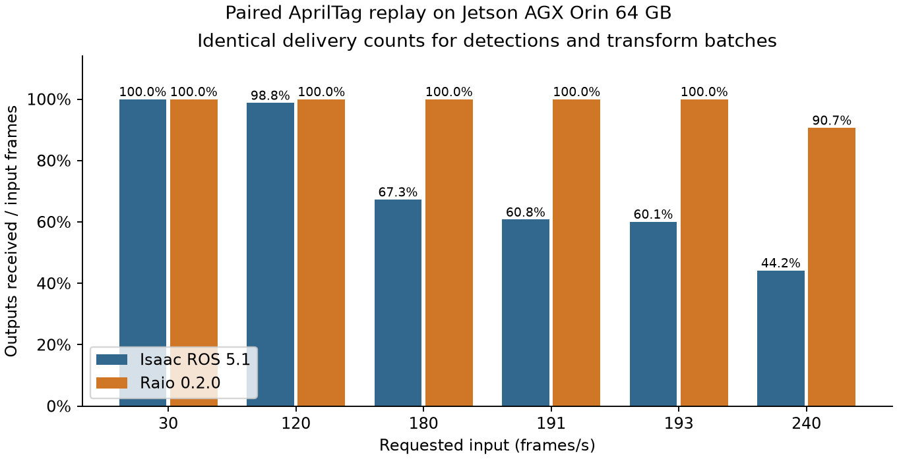

# AprilTag benchmark results

See [the reproduction and file guide](../../isaac_apriltag/README.md) to run these trials locally.

## Jetson AGX Orin 64 GB, Isaac ROS 5.1

JetPack 7.2.2 (MAXN), Raio 0.2.0. Each rate ran two launches of three 5 s bursts (0.5 s grace period). Clocks run from publication entry to detection receipt; p95 is the median across blocks, then across launches (`—` marks incomplete delivery). Detection and transform counts matched in every block.

| Target fps | Frames per runtime | Isaac ROS delivered | Raio delivered | Isaac ROS p95 (ms) | Raio p95 (ms) |
| --- | ---: | ---: | ---: | ---: | ---: |
| 30 | 900 | 900 (100.0%) | 900 (100.0%) | 17.78 | 13.53 |
| 120 | 3,600 | 3,557 (98.8%) | 3,600 (100.0%) | — | 5.71 |
| 180 | 5,400 | 3,635 (67.3%) | 5,400 (100.0%) | — | 46.55 |
| 191 | 5,730 | 3,482 (60.8%) | 5,730 (100.0%) | — | 62.08 |
| 193 | 5,790 | 3,479 (60.1%) | 5,790 (100.0%) | — | 62.71 |
| 240 | 7,200 | 3,183 (44.2%) | 6,528 (90.7%) | — | — |

At 240 fps, Isaac ROS offered 237.37–238.25 fps (two of six blocks missed the 1% tolerance) while Raio offered 239.999–240.005 fps. Raio finished all 7,200 frames 1.00–1.15 s after each burst; because the stock monitor stops at 0.5 s, late vs. dropped stock frames are indistinguishable.

### Stock benchmark and matched-input comparisons

At 191 fps, Raio hit 191.3 detections/s vs. 125.0 in NVIDIA’s stock benchmark (+53%). At 193 fps under the same paired harness (median inter-detection rate across six 5 s bursts, 0.5 s grace, `/tf` monitored), Raio hit 193.3 detections/s vs. 115.2 for Isaac ROS (+68%). NVIDIA’s stock script instead runs five bursts with a 5 s grace period and averages the middle three by total receipt span.

| Unmodified Isaac ROS 5.1 on this Jetson Orin | Reported input fps | Reported output fps |
| --- | ---: | ---: |
| [Default throughput search](stock/default.json) | 139.7 | 137.4 |
| [191 fps target](stock/fixed-191.json) | 190.3 | 125.0 |
| [240 fps target](stock/fixed-240.json) | 238.6 | 113.8 |

[NVIDIA’s release report](https://github.com/NVIDIA-ISAAC-ROS/isaac_ros_benchmark/blob/release-5.1/results/isaac_ros_apriltag_node-agx_orin.json) lists 191.0 detections/s at 193.0 fps on a Jetson AGX Orin (inside Raio’s 188.8–193.4 range), without RAM or clock details; why our local Isaac ROS runs are slower is unresolved.



Data: [Jetson Orin per-block CSV](orin-51-blocks.csv) · [Discovered ROS endpoints](ros-graph-endpoints.json) · [Graphviz source](isaac-ros-apriltag.dot)

The 180/240 and 191/193 fps pairs ran in reverse order on their second launch. To regenerate the Jetson Orin CSV and chart from two launch directories (with NumPy and Matplotlib), run from `benchmark/isaac_apriltag/`:

```sh
python3 analysis/collect_blocks.py --launch first /trial/first --launch second /trial/second ../results/isaac_apriltag/orin-51-blocks.csv
python3 analysis/plot_delivery.py ../results/isaac_apriltag/orin-51-blocks.csv ../results/isaac_apriltag/orin-51-delivery.png
```

## NVIDIA OVX A40 system replay results

One launch of three 5 s bursts per rate with active detection and `/tf` listeners (identical counts). Here, the stock clock starts just after publishing the image-and-calibration group; p95 runs to detection receipt (`—` marks incomplete delivery).

### Isaac ROS 4.6

Ten 720p frames repeat original camera timestamps. Raio sets image and calibration in one logical step; ROS matches timestamps on receipt.

| Target fps | Isaac ROS p95 (ms) | Raio p95 (ms) | Isaac ROS delivered | Raio delivered | Inputs |
| --- | ---: | ---: | ---: | ---: | ---: |
| 30 | 7.86 | 3.43 | 450 | 450 | 450 |
| 60 | 5.29 | 3.18 | 900 | 900 | 900 |
| 120 | 6.58 | 3.29 | 1,800 | 1,800 | 1,800 |
| 180 | — | 2.98 | 2,695 | 2,700 | 2,700 |
| 240 | — | 3.29 | 2,346 | 3,600 | 3,600 |

### Repeat with Isaac ROS 5.1

Raio 0.2.0 vs. ROS 2 Lyrical over the same ten image digests (three frames reordered in the 180 fps fixture). Every Raio output matched ROS tolerances (max rotation error 0.000002°).

| Target fps | Isaac ROS 5.1 p95 (ms) | Raio p95 (ms) | Isaac ROS delivered | Raio delivered | Inputs |
| --- | ---: | ---: | ---: | ---: | ---: |
| 30 | 7.66 | 3.33 | 450 | 450 | 450 |
| 60 | 4.86 | 3.18 | 900 | 900 | 900 |
| 120 | 5.28 | 3.26 | 1,800 | 1,800 | 1,800 |
| 180 | — | 3.16 | 2,697 | 2,700 | 2,700 |
| 240 | — | 3.00 | 2,597 | 3,600 | 3,600 |

At 240 fps, ROS offered 238.85, 240.06, and 234.99 fps (the third missed the 1% tolerance), delivering 170.81 median fps vs. Raio’s 239.98 fps (4.6 delivered 2,346/3,600). A 30 fps untouched 5.1 control delivered all 450 frames. See [the OVX A40 per-block CSV](a40-51-blocks.csv).

## Methodology

- **Interval & preload**: One warm-up plus three 5 s bursts per launch from a 10-frame GPU-preloaded buffer (bag I/O, resizing, and init excluded). Fixed-rate replay does not measure max throughput or live-camera latency.
- **Fixture & validation**: An auxiliary observer captures the 10 frames, calibration, and ROS detections (pre-timing in 4.6; post-timing at 5 fps reliable QoS in 5.1). Raio must match ROS within 0.05 px corners, 1 mm translation, and 0.1° rotation; any dropped frame suppresses p95.
- **Processes & IPC**: Single-host runs. Raio isolates playback, detector, and monitors in separate processes (TCP loopback for ports; CUDA IPC on OVX A40 or Unix-socket VMM FD on Jetson Orin). Stock composes playback, detector, and monitor in one multithreaded process (NITROS in 4.6, CUDA ROS images in 5.1; `rmw_fastrtps_cpp` / Fast DDS 2.14.7 on OVX A40 4.6) plus a `/tf` listener.
- **Transform port**: Both detectors publish detections and pose batches (`tag36h11:<id>`, empty when none) in one step to separate consumers (no TF tree queries). Pass `--no-transform-listener` to `raio/pipeline.py` to leave the transform port unwired.
- **Baseline**: Wraps NVIDIA’s [5.1 benchmark](https://github.com/NVIDIA-ISAAC-ROS/isaac_ros_benchmark/blob/release-5.1/benchmarks/isaac_ros_apriltag_benchmark/scripts/isaac_ros_apriltag_node.py) (`BufferPlaybackNode`), [4.6 benchmark](https://github.com/NVIDIA-ISAAC-ROS/isaac_ros_benchmark/blob/release-4.6/benchmarks/isaac_ros_apriltag_benchmark/scripts/isaac_ros_apriltag_node.py), and [4.6 detector](https://github.com/NVIDIA-ISAAC-ROS/isaac_ros_apriltag/blob/release-4.6/isaac_ros_apriltag/src/apriltag_node.cpp); OVX A40 4.6 and 5.1 `cuAprilTags` archives share SHA-256 `a7f32f58782de61dd23e507fe6ce5a907379498deec505669fe339ecd4facba7`.
