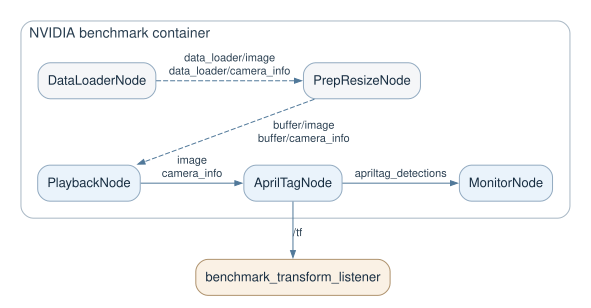

# Benchmarks

## Array latency

The repository has a benchmark that compares Raio with other middleware.

### Setup

The benchmark measures **latency**: the time to send an array from one node to another and multiply it, for a range of array sizes. It compares rclpy (ROS 2), Ray, Rosia, and Raio. The setup is that of the [Rosia benchmark](https://github.com/rosia-project/rosia-py/tree/main/benchmark).

### Running

The benchmark runs in Docker:

```bash
docker compose -f benchmark/docker-compose.yml up --build
```

Results are saved to `benchmark/results/`.

### Results

Results are not published here yet.

## AprilTag detection on Jetson AGX Orin

At a 191 fps input target, **Raio delivered 191.3 detections/s versus 125.0 for NVIDIA’s unmodified Isaac ROS 5.1 benchmark** on the same 64 GB Jetson AGX Orin Developer Kit. That is **53% higher detection throughput** for this 720p replay. Both pipelines used NVIDIA’s cuAprilTags detector and the same ten buffered images. The board ran JetPack 7.2.2 in MAXN mode.

| Comparison | Input target (fps) | Raio output (fps) | Isaac ROS output (fps) | Difference |
| --- | ---: | ---: | ---: | ---: |
| Same Orin, unmodified NVIDIA benchmark | 191 | 191.3 | 125.0 | +53% |
| Same Orin, both detections and transforms monitored | 193 | 193.3 | 115.2 | +68% |

The first row compares six five-second Raio bursts (median output rate, 0.5 s grace period) with NVIDIA’s five-burst procedure (trimmed mean output rate, 5 s grace period). The second row uses the same six-burst protocol and grace period for both runtimes. Raio delivered all 5,790 detections and transform batches there, with **62.7 ms p95** from publication to detection receipt. The paired Isaac ROS run delivered 3,479 of each.

On its own AGX Orin, NVIDIA reports **191.0 output fps at 193.0 input fps**. Raio’s six bursts at that input ranged from **188.8 to 193.4 output fps**, placing the published result within our measured range. On our board, the unmodified NVIDIA benchmark’s default throughput search reported 137.4 fps. The reason for the difference between the two Isaac ROS results is unresolved. [NVIDIA’s release report](https://github.com/NVIDIA-ISAAC-ROS/isaac_ros_benchmark/blob/release-5.1/results/isaac_ros_apriltag_node-agx_orin.json)


At a 240 fps target, 90.7% of Raio outputs and 44.2% of paired Isaac ROS outputs arrived within the measurement window. All of Raio’s remaining outputs arrived afterward. The experiment measures buffered replay in five-second bursts. [Method and reproduction commands](https://github.com/raio-robotics/raio/tree/main/benchmark/isaac_apriltag) · [Block measurements and stock reports](https://github.com/raio-robotics/raio/tree/main/benchmark/results/isaac_apriltag)

### AprilTag node graphs

#### Raio


Raio's built-in diagram shows the nodes, their ports, and the connections used in the paired run. Playback sends an image reference and its calibration to AprilTag. The detector sends tag detections to the timing monitor and poses to the transform monitor.

#### Isaac ROS 5.1



Dashed arrows show preparation of the playback buffer before timing. During the measured bursts, `PlaybackNode` sends the buffered images and calibration to `AprilTagNode`. `MonitorNode` measures detection receipt. The paired test adds the separate `/tf` listener. Topic labels omit the common `/r2b/` prefix. The diagram uses publisher and subscriber endpoints discovered during an AprilTag launch on the Orin. ROS 2 also provides `rqt_graph` for viewing the live node and topic graph. [ROS 2 graph viewer](https://github.com/ros-visualization/rqt_graph)
