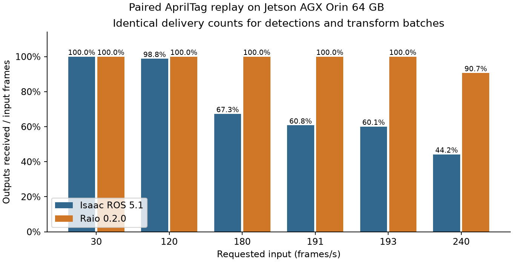
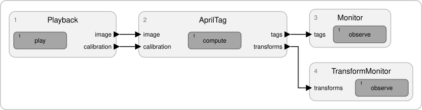

# Benchmarks

## Array latency

The repository has a benchmark that compares Raio with other middleware.

### Setup

The benchmark measures **latency**: the time to send an array from one node to another and multiply it, for a range of array sizes. It compares rclpy (ROS 2), Ray, Rosia, and Raio. The setup is that of the [Rosia benchmark](https://github.com/rosia-project/rosia-py/tree/main/benchmark).

### Running

The benchmark runs in Docker:

```bash
docker compose -f benchmark/docker-compose.yml up --build
```

Results are saved to `benchmark/results/`.

### Results

Results are not published here yet.

## AprilTag detection

We wanted to see how Raio holds up against NVIDIA’s Isaac ROS 5.1 on a real edge robot computer when both pipelines run the exact same detector underneath. On a 64 GB Jetson AGX Orin Developer Kit running JetPack 7.2.2 in MAXN mode, we fed NVIDIA’s cuAprilTags detector the same ten buffered 720p frames in each pipeline. At a 191 fps input target, **Raio delivered 191.3 detections/s compared to 125.0 for NVIDIA’s unmodified Isaac ROS 5.1 benchmark**—a **53% jump in throughput**.

| Comparison | Input target (fps) | Raio output (fps) | Isaac ROS output (fps) | Difference |
| --- | ---: | ---: | ---: | ---: |
| Same Jetson Orin, unmodified NVIDIA benchmark | 191 | 191.3 | 125.0 | +53% |
| Same Jetson Orin, both detections and transforms monitored | 193 | 193.3 | 115.2 | +68% |

Those two rows reflect slightly different ways of running the test. The first compares six five-second Raio bursts (median output rate with a 0.5 s grace period) directly against NVIDIA’s stock five-burst procedure (which trims the highest and lowest runs before averaging and waits 5 s after each burst). For the second row, we put both pipelines on the exact same footing: six five-second bursts, a 0.5 s grace period, and active listeners on both tag detections and transforms. Under that paired setup at 193 fps, Raio delivered all 5,790 detections and transform batches with a **62.7 ms p95** latency from publication to detection receipt, while Isaac ROS delivered 3,479 of each.

One quirk worth calling out: in [NVIDIA’s release report](https://github.com/NVIDIA-ISAAC-ROS/isaac_ros_benchmark/blob/release-5.1/results/isaac_ros_apriltag_node-agx_orin.json), NVIDIA lists **191.0 output fps at a 193.0 fps input** on a Jetson AGX Orin. That lands right inside Raio’s 193 fps range on our board (**188.8 to 193.4 output fps** across the six bursts). On our Jetson Orin, however, NVIDIA’s unmodified throughput search reported 137.4 fps—and we still haven’t pinned down why our local Isaac ROS runs trail NVIDIA’s published numbers.



Pushing the target rate up to 240 fps shows how many results each pipeline delivers at the higher input rate. At 240 fps, **90.7%** of Raio’s outputs made it inside the 0.5 s measurement window versus **44.2%** for the paired Isaac ROS run, and the rest of Raio’s outputs still finished arriving afterward. Everything here measures buffered replay in five-second bursts; if you want to check the numbers yourself, you can read the [method and reproduction commands](https://github.com/raio-robotics/raio/tree/main/benchmark/isaac_apriltag) or inspect the [per-block measurements and stock reports](https://github.com/raio-robotics/raio/tree/main/benchmark/results/isaac_apriltag).

### AprilTag node graphs

To make the plumbing concrete, here is how the two pipelines are actually wired together during the Jetson Orin runs.

#### Raio



Raio generates this diagram straight from the app itself. `Playback` hands an image reference and camera calibration to `AprilTag`, which splits its results across two downstream processes: tag detections go to `Monitor` for timing, and 3D poses go to `TransformMonitor`.

#### Isaac ROS 5.1


For Isaac ROS 5.1, we built the graph from the publisher and subscriber endpoints discovered during a live AprilTag launch on the Jetson Orin (dropping the common `/r2b/` prefix on topic names so the labels stay readable). Before timing starts, the dashed path loads and resizes frames into the playback buffer. Once a burst begins, `PlaybackNode` feeds those buffered images and calibration to `AprilTagNode`, `MonitorNode` clocks incoming detections, and our paired harness attaches a separate `/tf` listener outside the benchmark container. If you want to inspect a live ROS 2 graph yourself, ROS 2 ships [`rqt_graph`](https://github.com/ros-visualization/rqt_graph) for that.

### Running the AprilTag benchmark

[`benchmark/isaac_apriltag/README.md`](https://github.com/raio-robotics/raio/blob/main/benchmark/isaac_apriltag/README.md#reproduction)
