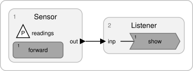

# Actions

<LanguageSelector />

An **action** is an input that is fed from outside the app: a sensor driver, a socket, the keyboard. It takes no connection. Instead, any thread of the node's own process can send a value to it.

## Physical Events

A value sent to an action is a **physical event**: its timestamp is the time of the wall clock when the value arrives. Below, a thread stands in for a sensor driver and feeds the action `readings` of a `Sensor` node.

<Python>

The task `forward` starts the thread and then reads the action like an input port: **`async for`** yields each value as it arrives. The thread calls **`readings.send`** for each reading, and **`readings.close()`** when it has no more, which ends the loop in `forward`.

</Python>
<Rust>

The task `forward` takes a **handle** of the action and moves it into the thread, then reads the action like an input port: **`wait()`** yields each value as it arrives. The thread calls **`handle.send`** for each reading. When the thread ends, the handle is dropped, which closes the action and ends the loop in `forward`.

</Rust>



<Python>

```python title="action.py" {7,13,19-20}
import threading
import time
import raio
from raio import Action, InputPort, Node, OutputPort, reaction, task

class Sensor(Node):
    readings = Action[float]()
    out = OutputPort[float]()

    @task
    async def forward(self):
        threading.Thread(target=self.read, daemon=True).start()
        async for reading in self.readings:
            self.out.set(reading)

    def read(self):
        for reading in (0.1, 0.2, 0.3):
            time.sleep(0.1)
            self.readings.send(reading)
        self.readings.close()

class Listener(Node):
    inp = InputPort[float]()

    @reaction(inp)
    def show(self):
        print(f"received {self.inp.value} (physical: {raio.is_physical()})")

sensor, listener = Sensor(), Listener()
raio.connect(sensor.out, listener.inp)
raio.run(sensor, listener)
```

</Python>
<Rust>

```rust title="src/main.rs" {10,23,27,30}
use raio::app::{Action, App, Builder, InputPort, Node, OutputPort, Ports};
use raio::reaction;
use raio::tasks;
use std::rc::Rc;
use std::thread;
use std::time::Duration;

#[derive(Ports)]
struct Sensor {
    readings: Action<f64>,
    out: OutputPort<f64>,
}

impl Sensor {
    fn new(builder: &mut Builder) -> Self {
        Self {
            readings: builder.action(),
            out: builder.output(),
        }
    }

    async fn forward(self: Rc<Self>) {
        let handle = self.readings.handle();
        thread::spawn(move || {
            for reading in [0.1, 0.2, 0.3] {
                thread::sleep(Duration::from_millis(100));
                handle.send(reading);
            }
        });
        while let Some((reading, _)) = self.readings.wait().await {
            self.out.set(*reading);
        }
    }
}

#[derive(Ports)]
struct Listener {
    node: Node,
    inp: InputPort<f64>,
}

impl Listener {
    fn new(builder: &mut Builder) -> Self {
        Self {
            node: builder.node(),
            inp: builder.input(),
        }
    }

    async fn show(self: Rc<Self>) {
        reaction!(self, [inp], {
            println!(
                "received {} (physical: {})",
                *self.inp.get().unwrap(),
                self.node.is_physical()
            );
        });
    }
}

fn main() {
    let mut app = App::new();
    let sensor = app.create_node(Sensor::new, tasks![Sensor::forward]);
    let listener = app.create_node(Listener::new, tasks![Listener::show]);
    app.connect(&sensor.out, &listener.inp);
    app.run();
}
```

</Rust>

<Python>

```console
$ python action.py
received 0.1 (physical: True)
received 0.2 (physical: True)
received 0.3 (physical: True)
```

</Python>
<Rust>

```console
$ cargo run
received 0.1 (physical: true)
received 0.2 (physical: true)
received 0.3 (physical: true)
```

</Rust>

<Python>

**`raio.is_physical()`** is true at a timestamp that came from the wall clock. Here it is true in `Listener` as well: the reading keeps its timestamp as it travels through the connection.

</Python>
<Rust>

**`node.is_physical()`** is true at a timestamp that came from the wall clock. Here it is true in `Listener` as well: the reading keeps its timestamp as it travels through the connection.

</Rust>

The timestamps of physical events differ from one run to the next, because they depend on when each value arrived. Everything that follows from them is deterministic again: given the same readings at the same timestamps, the app behaves the same.

An action can also trigger a [reaction](reactions.md), just as an input port can.

A task that reads an action ends only when the action is closed. A node whose action is never closed therefore never finishes on its own, and its app runs until it is shut down.

## Why a Thread

A node runs its tasks and reactions on a single thread, and that thread must not block: a node that is silent for five seconds is treated as failed (see [Shutdown](shutdown.md)). Work that blocks, such as reading from a device, therefore belongs in a thread of its own that reports through an action.
