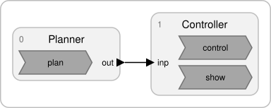
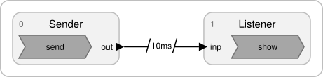
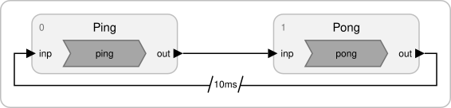
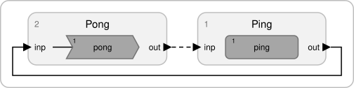

# Connections

<LanguageSelector />

A **connection** sends every value of an output port to an input port. By default the value arrives at the timestamp at which it was sent.

An output port may have any number of connections, each with its own settings, and every connected input receives every value. An input port has exactly one connection. The two nodes are separate processes, so the receiver gets a copy of each value, never the sender's own object.

## Waiting for the Sender

A receiver handles a timestamp only once it knows that its sender will send nothing at or before that timestamp. This is what keeps the order of events the same in every run. It also means that a slow sender holds its receiver back, even in work that has nothing to do with the sender.

Below, `Planner` is busy for `400ms` at `1ms`. `Controller` has a task of its own that ticks every millisecond and prints its lag.



<Python>

```python title="slow_sender.py" {11,28}
import time
import raio
from raio import MS, InputPort, Node, OutputPort, reaction, task

class Planner(Node):
    out = OutputPort[str]()

    @task
    async def plan(self):
        await raio.wait(1 * MS)
        time.sleep(0.4)
        self.out.set("plan")

class Controller(Node):
    inp = InputPort[str]()

    @task
    async def control(self):
        for _ in range(3):
            now = await raio.wait(1 * MS)
            print(f"control at {now}, lag {raio.physical_now() - now}")

    @reaction(inp)
    def show(self):
        print(f"received {self.inp.value} at {raio.now()}")

planner, controller = Planner(), Controller()
raio.connect(planner.out, controller.inp)
raio.run(planner, controller)
```

</Python>
<Rust>

```rust title="src/main.rs" {24,66}
use raio::app::{App, Builder, InputPort, Node, OutputPort, Ports, node};
use raio::time::MS;
use std::thread;
use std::time::Duration;

#[derive(Ports)]
struct Planner {
    node: Node,
    out: OutputPort<String>,
}

#[node]
impl Planner {
    fn new(builder: &mut Builder) -> Self {
        Self {
            node: builder.node(),
            out: builder.output(),
        }
    }

    #[task]
    async fn plan(&self) {
        self.node.wait(1 * MS).await;
        thread::sleep(Duration::from_millis(400));
        self.out.set("plan".to_string());
    }
}

#[derive(Ports)]
struct Controller {
    node: Node,
    inp: InputPort<String>,
}

#[node]
impl Controller {
    fn new(builder: &mut Builder) -> Self {
        Self {
            node: builder.node(),
            inp: builder.input(),
        }
    }

    #[task]
    async fn control(&self) {
        for _ in 0..3 {
            let now = self.node.wait(1 * MS).await;
            println!("control at {now}, lag {}", self.node.physical_now() - now);
        }
    }

    #[reaction(inp)]
    fn show(&self) {
        println!(
            "received {} at {}",
            *self.inp.get().unwrap(),
            self.node.now()
        );
    }
}

fn main() {
    let mut app = App::new();
    let planner = app.create_node(Planner::new);
    let controller = app.create_node(Controller::new);
    app.connect(&planner.out, &controller.inp);
    app.run();
}
```

</Rust>

<Python>

```console
$ python slow_sender.py
control at 1ms, lag 401515375ns
received plan at 1ms
control at 2ms, lag 400837625ns
control at 3ms, lag 399856542ns
```

</Python>
<Rust>

```console
$ cargo run
control at 1ms, lag 402040791ns
received plan at 1ms
control at 2ms, lag 401122791ns
control at 3ms, lag 400134541ns
```

</Rust>

`Controller` could not handle `1ms` until `Planner` had finished it, so every tick is `400ms` late. Once `Planner` has finished and its output has closed, `Controller` waits for it no longer.

## Delays

A connection may have a **delay**, which shifts every value later in logical time. A delay is zero or more.

<Python>

Below, `Sender` sets its output at `1ms`, and the connection is made with **`delay=10 * MS`**.

</Python>
<Rust>

Below, `Sender` sets its output at `1ms`, and the connection is made with **`.delay(10 * MS)`**.

</Rust>



<Python>

```python title="delay.py" {20}
import raio
from raio import MS, InputPort, Node, OutputPort, reaction, task

class Sender(Node):
    out = OutputPort[str]()

    @task
    async def send(self):
        await raio.wait(1 * MS)
        self.out.set("hello")

class Listener(Node):
    inp = InputPort[str]()

    @reaction(inp)
    def show(self):
        print(f"{self.inp.value} at {raio.now()}")

sender, listener = Sender(), Listener()
raio.connect(sender.out, listener.inp, delay=10 * MS)
raio.run(sender, listener)
```

</Python>
<Rust>

```rust title="src/main.rs" {51}
use raio::app::{App, Builder, InputPort, Node, OutputPort, Ports, node};
use raio::time::MS;

#[derive(Ports)]
struct Sender {
    node: Node,
    out: OutputPort<String>,
}

#[node]
impl Sender {
    fn new(builder: &mut Builder) -> Self {
        Self {
            node: builder.node(),
            out: builder.output(),
        }
    }

    #[task]
    async fn send(&self) {
        self.node.wait(1 * MS).await;
        self.out.set("hello".to_string());
    }
}

#[derive(Ports)]
struct Listener {
    node: Node,
    inp: InputPort<String>,
}

#[node]
impl Listener {
    fn new(builder: &mut Builder) -> Self {
        Self {
            node: builder.node(),
            inp: builder.input(),
        }
    }

    #[reaction(inp)]
    fn show(&self) {
        println!("{} at {}", *self.inp.get().unwrap(), self.node.now());
    }
}

fn main() {
    let mut app = App::new();
    let sender = app.create_node(Sender::new);
    let listener = app.create_node(Listener::new);
    app.connect(&sender.out, &listener.inp).delay(10 * MS);
    app.run();
}
```

</Rust>

<Python>

```console
$ python delay.py
hello at 11ms
```

</Python>
<Rust>

```console
$ cargo run
hello at 11ms
```

</Rust>

The value arrives at `11ms`: the timestamp at which it was sent, plus the delay.

A delay also decides how far a receiver may run ahead of its sender. With a delay of `10ms`, the receiver may be up to `10ms` ahead, because nothing the sender does now can reach it sooner. A slow sender therefore holds the receiver back less.

<Python>

In the app of `Planner` and `Controller` above, making the connection with `delay=50 * MS` gives this:

</Python>
<Rust>

In the app of `Planner` and `Controller` above, making the connection with `.delay(50 * MS)` gives this:

</Rust>

<Python>

```console
$ python slow_sender.py
control at 1ms, lag 128083ns
control at 2ms, lag 137708ns
control at 3ms, lag 112541ns
received plan at 51ms
```

</Python>
<Rust>

```console
$ cargo run
control at 1ms, lag 118667ns
control at 2ms, lag 125875ns
control at 3ms, lag 116875ns
received plan at 51ms
```

</Rust>

The control loop now keeps its rate, with a lag of a fraction of a millisecond, while the planner is still working. The price is that the plan arrives `50ms` later in logical time, at `51ms`.

## Loops

Connections may form a loop, in which a node's output finds its way back to one of its own inputs. A loop needs a delay somewhere in it.

Below, `Ping` sends a count, and `Pong` adds one and replies at the same timestamp. The reply travels over the connection from `Pong` back to `Ping`, which has a delay of `10ms`.



<Python>

```python title="loop.py" {27}
import raio
from raio import MS, InputPort, Node, OutputPort, reaction, task

class Ping(Node):
    inp = InputPort[int]()
    out = OutputPort[int]()

    @task
    async def ping(self):
        await raio.wait(1 * MS)
        count = 0
        for _ in range(3):
            self.out.set(count)
            count = await self.inp
            print(f"ping got {count} at {raio.now()}")

class Pong(Node):
    inp = InputPort[int]()
    out = OutputPort[int]()

    @reaction(inp)
    def pong(self):
        self.out.set(self.inp.value + 1)

ping, pong = Ping(), Pong()
raio.connect(ping.out, pong.inp)
raio.connect(pong.out, ping.inp, delay=10 * MS)
raio.run(ping, pong)
```

</Python>
<Rust>

```rust title="src/main.rs" {60}
use raio::app::{App, Builder, InputPort, Node, OutputPort, Ports, node};
use raio::time::MS;

#[derive(Ports)]
struct Ping {
    node: Node,
    inp: InputPort<i64>,
    out: OutputPort<i64>,
}

#[node]
impl Ping {
    fn new(builder: &mut Builder) -> Self {
        Self {
            node: builder.node(),
            inp: builder.input(),
            out: builder.output(),
        }
    }

    #[task]
    async fn ping(&self) {
        self.node.wait(1 * MS).await;
        let mut count = 0;
        for _ in 0..3 {
            self.out.set(count);
            let (reply, _) = self.inp.wait().await.unwrap();
            count = *reply;
            println!("ping got {count} at {}", self.node.now());
        }
    }
}

#[derive(Ports)]
struct Pong {
    inp: InputPort<i64>,
    out: OutputPort<i64>,
}

#[node]
impl Pong {
    fn new(builder: &mut Builder) -> Self {
        Self {
            inp: builder.input(),
            out: builder.output(),
        }
    }

    #[reaction(inp)]
    fn pong(&self) {
        self.out.set(*self.inp.get().unwrap() + 1);
    }
}

fn main() {
    let mut app = App::new();
    let ping = app.create_node(Ping::new);
    let pong = app.create_node(Pong::new);
    app.connect(&ping.out, &pong.inp);
    app.connect(&pong.out, &ping.inp).delay(10 * MS);
    app.run();
}
```

</Rust>

<Python>

```console
$ python loop.py
ping got 1 at 11ms
ping got 2 at 21ms
ping got 3 at 31ms
```

</Python>
<Rust>

```console
$ cargo run
ping got 1 at 11ms
ping got 2 at 21ms
ping got 3 at 31ms
```

</Rust>

Each round of the loop takes exactly the delay, so the replies arrive at `11ms`, `21ms` and `31ms`.

:::note

In a loop without a delay, each node waits for the other before it handles a timestamp, and the app makes no progress.

:::

## Physical Connections

A **physical connection** gives each value a timestamp from the receiver's own clock at the moment the value arrives. The receiver never waits for the sender, so a loop that contains a physical connection needs no delay. A physical connection takes no delay of its own: an app that gives it one does not start.

<Python>

The app below is the loop above with **`physical=True`** in place of the delay. `Ping` also prints whether each reply arrived at a timestamp that came from the wall clock.

</Python>
<Rust>

The app below is the loop above with **`.physical()`** in place of the delay. `Ping` also prints whether each reply arrived at a timestamp that came from the wall clock.

</Rust>



<Python>

```python title="physical.py" {15,27}
import raio
from raio import MS, InputPort, Node, OutputPort, reaction, task

class Ping(Node):
    inp = InputPort[int]()
    out = OutputPort[int]()

    @task
    async def ping(self):
        count = 0
        for _ in range(3):
            await raio.wait(1 * MS)
            self.out.set(count)
            count = await self.inp
            print(f"ping got {count} (physical: {raio.is_physical()})")

class Pong(Node):
    inp = InputPort[int]()
    out = OutputPort[int]()

    @reaction(inp)
    def pong(self):
        self.out.set(self.inp.value + 1)

ping, pong = Ping(), Pong()
raio.connect(ping.out, pong.inp)
raio.connect(pong.out, ping.inp, physical=True)
raio.run(ping, pong)
```

</Python>
<Rust>

```rust title="src/main.rs" {29,60}
use raio::app::{App, Builder, InputPort, Node, OutputPort, Ports, node};
use raio::time::MS;

#[derive(Ports)]
struct Ping {
    node: Node,
    inp: InputPort<i64>,
    out: OutputPort<i64>,
}

#[node]
impl Ping {
    fn new(builder: &mut Builder) -> Self {
        Self {
            node: builder.node(),
            inp: builder.input(),
            out: builder.output(),
        }
    }

    #[task]
    async fn ping(&self) {
        let mut count = 0;
        for _ in 0..3 {
            self.node.wait(1 * MS).await;
            self.out.set(count);
            let (reply, _) = self.inp.wait().await.unwrap();
            count = *reply;
            println!("ping got {count} (physical: {})", self.node.is_physical());
        }
    }
}

#[derive(Ports)]
struct Pong {
    inp: InputPort<i64>,
    out: OutputPort<i64>,
}

#[node]
impl Pong {
    fn new(builder: &mut Builder) -> Self {
        Self {
            inp: builder.input(),
            out: builder.output(),
        }
    }

    #[reaction(inp)]
    fn pong(&self) {
        self.out.set(*self.inp.get().unwrap() + 1);
    }
}

fn main() {
    let mut app = App::new();
    let ping = app.create_node(Ping::new);
    let pong = app.create_node(Pong::new);
    app.connect(&ping.out, &pong.inp);
    app.connect(&pong.out, &ping.inp).physical();
    app.run();
}
```

</Rust>

<Python>

```console
$ python physical.py
ping got 1 (physical: True)
ping got 2 (physical: True)
ping got 3 (physical: True)
```

</Python>
<Rust>

```console
$ cargo run
ping got 1 (physical: true)
ping got 2 (physical: true)
ping got 3 (physical: true)
```

</Rust>

<Python>

**`raio.is_physical()`** is true at a timestamp that came from the wall clock. Because the timestamp of each reply depends on when it arrived, it differs from one run to the next.

</Python>
<Rust>

**`node.is_physical()`** is true at a timestamp that came from the wall clock. Because the timestamp of each reply depends on when it arrived, it differs from one run to the next.

</Rust>

The three kinds of connection trade determinism against waiting. See [Consistency and Availability](../concepts/consistency-and-availability.md) for how to choose.
