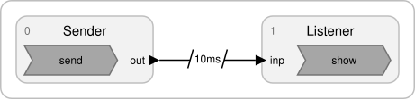

# Drawing an App

<LanguageSelector />

A **diagram** is a picture of an app: its nodes, their ports, and the connections between them. Raio draws it from the app itself, so the picture always matches the code.

## Drawing a Diagram

<Python>

The program below builds an app of two nodes. In place of running it, **`raio.diagram`** draws it: the call takes the path of the file to write, here `hello.svg`, and the nodes of the app.

</Python>
<Rust>

The program below builds an app of two nodes. In place of running it, **`app.diagram`** draws it: the call takes the path of the file to write, here `hello.svg`.

</Rust>

<Python>

```python title="diagram.py" {21}
import raio
from raio import MS, InputPort, Node, OutputPort, reaction, task

class Sender(Node):
    out = OutputPort[str]()

    @task
    async def send(self):
        await raio.wait(1 * MS)
        self.out.set("hello world")

class Listener(Node):
    inp = InputPort[str]()

    @reaction(inp)
    def show(self):
        print(self.inp.value)

sender, listener = Sender(), Listener()
raio.connect(sender.out, listener.inp, delay=10 * MS)
raio.diagram("hello.svg", sender, listener)
```

</Python>
<Rust>

```rust title="src/main.rs" {53}
use raio::app::{App, Builder, InputPort, Node, OutputPort, Ports};
use raio::reaction;
use raio::tasks;
use raio::time::MS;
use std::rc::Rc;

#[derive(Ports)]
struct Sender {
    node: Node,
    out: OutputPort<String>,
}

impl Sender {
    fn new(builder: &mut Builder) -> Self {
        Self {
            node: builder.node(),
            out: builder.output(),
        }
    }

    async fn send(self: Rc<Self>) {
        self.node.wait(1 * MS).await;
        self.out.set("hello world".to_string());
    }
}

#[derive(Ports)]
struct Listener {
    node: Node,
    inp: InputPort<String>,
}

impl Listener {
    fn new(builder: &mut Builder) -> Self {
        Self {
            node: builder.node(),
            inp: builder.input(),
        }
    }

    async fn show(self: Rc<Self>) {
        reaction!(self, [inp], {
            println!("{} at {}", *self.inp.get().unwrap(), self.node.now());
        });
    }
}

fn main() {
    let mut app = App::new();
    let sender = app.create_node(Sender::new, tasks![Sender::send]);
    let listener = app.create_node(Listener::new, tasks![Listener::show]);
    app.connect(&sender.out, &listener.inp).delay(10 * MS);
    app.diagram("hello.svg");
}
```

</Rust>

The call draws the app and returns; it does not run it. A program can both draw and run its app. The file it writes is this picture:



## Reading a Diagram

In the diagram above:

- Each box is a node, shown by the name of its type, with its position in the app in the corner.
- A port is on the edge of its node, labelled with its name.
- The grey shapes inside a node are its tasks and reactions, shown by the names of their methods.
- A connection is a line from an output port to an input port. A delay is written on the line.
- A physical connection is a dashed line.

<Python>

A port has the name of its attribute on the node class.

</Python>
<Rust>

A port has the name of the field that holds it, which `#[derive(Ports)]` reads. A port that no field holds is shown by its position.

</Rust>

The nodes are placed and the connections routed by [elkrs](https://github.com/depetrol/elkrs).

Every program in this tutorial is shown with the diagram that Raio draws of it.
