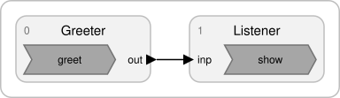
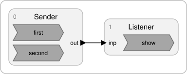

# Nodes and Ports

<LanguageSelector />

An app in Raio is a set of **nodes** that exchange values through **ports**.

In the app below, a `Greeter` node sends one value, and a `Listener` node prints each value it receives, with its timestamp.



<Python>

```python title="nodes.py" {5,10,16,18,23}
import raio
from raio import MS, InputPort, Node, OutputPort, reaction, task

class Greeter(Node):
    out = OutputPort[str]()

    def __init__(self, name: str):
        self.name = name

    @task
    async def greet(self):
        await raio.wait(1 * MS)
        self.out.set(f"hello from {self.name}")

class Listener(Node):
    inp = InputPort[str]()

    @reaction(inp)
    def show(self):
        print(f"{self.inp.value} at {self.inp.time}")

greeter, listener = Greeter("raio"), Listener()
raio.connect(greeter.out, listener.inp)
raio.run(greeter, listener)
```

</Python>
<Rust>

```rust title="src/main.rs" {7,21,30,41,52}
use raio::app::{App, Builder, InputPort, Node, OutputPort, Ports, node};
use raio::time::MS;

#[derive(Ports)]
struct Greeter {
    node: Node,
    out: OutputPort<String>,
    name: String,
}

#[node]
impl Greeter {
    fn new(builder: &mut Builder, name: &str) -> Self {
        Self {
            node: builder.node(),
            out: builder.output(),
            name: name.to_string(),
        }
    }

    #[task]
    async fn greet(&self) {
        self.node.wait(1 * MS).await;
        self.out.set(format!("hello from {}", self.name));
    }
}

#[derive(Ports)]
struct Listener {
    inp: InputPort<String>,
}

#[node]
impl Listener {
    fn new(builder: &mut Builder) -> Self {
        Self {
            inp: builder.input(),
        }
    }

    #[reaction(inp)]
    fn show(&self) {
        let (value, time) = self.inp.latest().unwrap();
        println!("{} at {}", *value, time);
    }
}

fn main() {
    let mut app = App::new();
    let greeter = app.create_node(|builder| Greeter::new(builder, "raio"));
    let listener = app.create_node(Listener::new);
    app.connect(&greeter.out, &listener.inp);
    app.run();
}
```

</Rust>

<Python>

```console
$ python nodes.py
hello from raio at 1ms
```

</Python>
<Rust>

```console
$ cargo run
hello from raio at 1ms
```

</Rust>

## Nodes

<Python>

A **node** is a class that inherits from **`Node`**. Each node of an app runs in its own process, so nodes share no memory: everything one node tells another goes through a port.

A node takes its settings in **`__init__`**, like any other class. Above, `Greeter("raio")` builds a node whose `name` is `"raio"`.

`__init__` runs in the process that builds the app. Raio then copies the node, with its attributes, to a process of its own, where its tasks run. So everything `__init__` stores on the node must be picklable. Things that are not, such as a thread, a lock or an open socket, are created inside a task.

</Python>
<Rust>

A **node** is a struct that derives **`Ports`**. Each node of an app runs in its own process, so nodes share no memory: everything one node tells another goes through a port.

A node is built by a function that takes a **`Builder`**. The builder creates the node's ports and its **`Node`** handle, which the node uses to wait and to tell the time. What the node does is in the methods of its `impl` block, which is marked **`#[node]`**. A node takes its settings as further arguments of that function. Above, `Greeter::new(builder, "raio")` builds a node whose `name` is `"raio"`.

Every process of an app runs the same program. `main` therefore runs once in the process that launches the app and once more in each node's process, and each of these processes builds every node before it runs its own. So code that should run once per node belongs in a task, not in `main` or in the function that builds the node.

</Rust>

## Ports

<Python>

Ports are declared as class attributes, and each node instance gets its own. An **output port** sends values, and an **input port** receives the values of one output port. The type in brackets is the type of the values, and a type checker verifies that the two ends of a connection agree.

A port belongs to its node. Only that node can use it, and only while it runs: reading `listener.inp.value` in the process that builds the app raises an error.

</Python>
<Rust>

Ports are fields of the struct. An **output port** sends values, and an **input port** receives the values of one output port. The type in angle brackets is the type of the values, and the compiler verifies that the two ends of a connection agree.

</Rust>

Every input port of an app must be connected to exactly one output port. An app with an input that has no connection, or two, does not start. An output port may feed any number of inputs, including none.

## Tasks

<Python>

A **task** is an `async` method marked with **`@task`**. Every task of a node starts when the node starts, and the node finishes when all of its tasks have ended.

</Python>
<Rust>

A **task** is an `async` method marked with **`#[task]`**. Every task of a node starts when the node starts, and the node finishes when all of its tasks have ended.

</Rust>

The tasks of a node never run at the same moment. They start in the order in which they are declared, and each one runs until it waits for something or ends. Only then does the next one run. The same holds every time they resume: tasks that are due at the same timestamp run one after another, in the order in which they are declared.

Below, `Sender` has two tasks. Each prints a line, waits one millisecond, and then sets the same output.



<Python>

```python title="sending.py" {11,18}
import raio
from raio import MS, InputPort, Node, OutputPort, reaction, task

class Sender(Node):
    out = OutputPort[str]()

    @task
    async def first(self):
        print("first starts")
        await raio.wait(1 * MS)
        self.out.set("from first")
        print("first has set the output")

    @task
    async def second(self):
        print("second starts")
        await raio.wait(1 * MS)
        self.out.set("from second")
        print("second has set the output")

class Listener(Node):
    inp = InputPort[str]()

    @reaction(inp)
    def show(self):
        print(f"received '{self.inp.value}' at {self.inp.time}")

sender, listener = Sender(), Listener()
raio.connect(sender.out, listener.inp)
raio.run(sender, listener)
```

</Python>
<Rust>

```rust title="src/main.rs" {23,31}
use raio::app::{App, Builder, InputPort, Node, OutputPort, Ports, node};
use raio::time::MS;

#[derive(Ports)]
struct Sender {
    node: Node,
    out: OutputPort<String>,
}

#[node]
impl Sender {
    fn new(builder: &mut Builder) -> Self {
        Self {
            node: builder.node(),
            out: builder.output(),
        }
    }

    #[task]
    async fn first(&self) {
        println!("first starts");
        self.node.wait(1 * MS).await;
        self.out.set("from first".to_string());
        println!("first has set the output");
    }

    #[task]
    async fn second(&self) {
        println!("second starts");
        self.node.wait(1 * MS).await;
        self.out.set("from second".to_string());
        println!("second has set the output");
    }
}

#[derive(Ports)]
struct Listener {
    inp: InputPort<String>,
}

#[node]
impl Listener {
    fn new(builder: &mut Builder) -> Self {
        Self {
            inp: builder.input(),
        }
    }

    #[reaction(inp)]
    fn show(&self) {
        let (value, time) = self.inp.latest().unwrap();
        println!("received '{}' at {}", *value, time);
    }
}

fn main() {
    let mut app = App::new();
    let sender = app.create_node(Sender::new);
    let listener = app.create_node(Listener::new);
    app.connect(&sender.out, &listener.inp);
    app.run();
}
```

</Rust>

<Python>

```console
$ python sending.py
first starts
second starts
first has set the output
second has set the output
received 'from second' at 1ms
```

</Python>
<Rust>

```console
$ cargo run
first starts
second starts
first has set the output
second has set the output
received 'from second' at 1ms
```

</Rust>

Both tasks start at timestamp zero, `first` before `second`, and each runs up to its wait. At `1ms` both are due again, and again `first` runs before `second`.

## Setting an Output

<Python>

A node sets an output with **`out.set(value)`**. Setting an output does not send the value at once. The value is sent when the node's current timestamp is **complete**: when every task of the node is waiting for something later, or has ended.

</Python>
<Rust>

A node sets an output with **`out.set(value)`**. Setting an output does not send the value at once. The value is sent when the node's current timestamp is **complete**: when every task of the node is waiting for something later, or has ended.

</Rust>

An output holds one value per timestamp. In the program above both tasks set `out` at `1ms`, so the second value replaces the first, and `Listener` receives only `from second`. It receives it after both tasks have finished their work at `1ms`.

<Python>

`out.reset()` clears a value that was set at the current timestamp, so that nothing is sent.

Because the value is sent when the timestamp completes, it is also read then. A list that is changed after `set`, but before the task next waits, is sent with the change.

</Python>
<Rust>

`out.reset()` clears a value that was set at the current timestamp, so that nothing is sent.

</Rust>

:::note

An app starts at timestamp zero, and a node cannot set an output at that timestamp. A task therefore waits before it sets its first output.

:::

## Reading an Input

<Python>

A node reads an input with **`inp.value`**, the latest value received, and **`inp.time`**, the timestamp of that value. Before the first value arrives, `inp.value` is `None`.

An input keeps its latest value. Reading it does not use it up, and it stays until the next value replaces it.

</Python>
<Rust>

A node reads an input with **`inp.latest()`**, which returns the latest value received and the timestamp of that value, or `None` before the first value arrives. `inp.get()` returns the value only at the timestamp at which it arrived.

An input keeps its latest value. Reading it does not use it up, and it stays until the next value replaces it.

</Rust>

A value arrives at the timestamp at which it was sent. Above, `Greeter` sets its output at `1ms`, and `Listener` receives the value at `1ms`, however long the value took to travel between the two processes.

## Reactions

<Python>

A **reaction** is a method marked with **`@reaction(port)`**. It runs each time the port receives a value. Above, `show` runs once, at `1ms`, when the greeting arrives.

</Python>
<Rust>

A **reaction** is a method marked with **`#[reaction(port)]`**. It runs each time the port receives a value. Above, `show` runs once, at `1ms`, when the greeting arrives.

</Rust>

See [Reactions](reactions.md) for more.

## When a Node Finishes

A node finishes when all of its tasks have ended. Its output ports then **close**: no more values will come from them.

A reaction ends when its port closes. Above, `Greeter` finishes after its one task has sent the greeting. Its output closes, the reaction of `Listener` ends, and `Listener` has no other work, so it finishes too. An app is over when all of its nodes have finished.

## Connecting and Running

<Python>

**`raio.connect(greeter.out, listener.inp)`** sends every value of the output port to the input port. One output can feed several inputs, but an input takes exactly one output.

**`raio.run(greeter, listener)`** starts each node in its own process and returns when all of them have finished.

</Python>
<Rust>

**`app.create_node`** takes the function that builds a node. **`app.connect(&greeter.out, &listener.inp)`** sends every value of the output port to the input port. One output can feed several inputs, but an input takes exactly one output.

**`app.run()`** starts each node in its own process and returns when all of them have finished.

</Rust>
