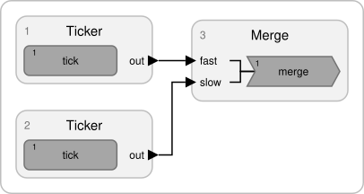
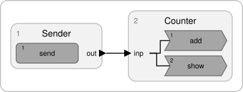

# Reactions

<LanguageSelector />

A **reaction** is a piece of a node that runs once at each timestamp at which one of its **triggers** has a value. A trigger is an input port or an [action](actions.md) of the node.

## Triggers and Presence

A reaction may have several triggers. Below, a `Merge` node has one reaction that is triggered by two inputs. A `fast` ticker feeds one input every `500ms`, and a `slow` ticker feeds the other every second.

<Python>

An input is **present** at a timestamp if a value arrived at that timestamp. The reaction prints both for each input: **`port.value`**, which keeps the latest value (`None` before the first one), and **`port.present`**.

</Python>
<Rust>

An input is **present** at a timestamp if a value arrived at that timestamp. The reaction prints both for each input: **`port.latest()`**, which keeps the latest value (`None` before the first one), and whether **`port.get()`**, the value at this timestamp, is there.

</Rust>



<Python>

```python title="reaction.py" {21,23}
import raio
from raio import MS, InputPort, Node, OutputPort, S, Time, reaction, task

class Ticker(Node):
    out = OutputPort[int]()

    def __init__(self, period: Time, ticks: int):
        self.period = period
        self.ticks = ticks

    @task
    async def tick(self):
        for count in range(self.ticks):
            await raio.wait(self.period)
            self.out.set(count)

class Merge(Node):
    fast = InputPort[int]()
    slow = InputPort[int]()

    @reaction(fast, slow)
    def merge(self):
        print(f"{raio.now()}: fast {self.fast.value} ({self.fast.present}), slow {self.slow.value} ({self.slow.present})")

fast, slow, merge = Ticker(500 * MS, 4), Ticker(1 * S, 2), Merge()
raio.connect(fast.out, merge.fast)
raio.connect(slow.out, merge.slow)
raio.run(fast, slow, merge)
```

</Python>
<Rust>

```rust title="src/main.rs" {50,54-57}
use raio::app::{App, Builder, InputPort, Node, OutputPort, Ports};
use raio::reaction;
use raio::tasks;
use raio::time::{MS, S, Time};
use std::rc::Rc;

#[derive(Ports)]
struct Ticker {
    node: Node,
    out: OutputPort<i64>,
    period: Time,
    ticks: i64,
}

impl Ticker {
    fn new(builder: &mut Builder, period: Time, ticks: i64) -> Self {
        Self {
            node: builder.node(),
            out: builder.output(),
            period,
            ticks,
        }
    }

    async fn tick(self: Rc<Self>) {
        for count in 0..self.ticks {
            self.node.wait(self.period).await;
            self.out.set(count);
        }
    }
}

#[derive(Ports)]
struct Merge {
    node: Node,
    fast: InputPort<i64>,
    slow: InputPort<i64>,
}

impl Merge {
    fn new(builder: &mut Builder) -> Self {
        Self {
            node: builder.node(),
            fast: builder.input(),
            slow: builder.input(),
        }
    }

    async fn merge(self: Rc<Self>) {
        reaction!(self, [fast, slow], {
            println!(
                "{}: fast {:?} ({}), slow {:?} ({})",
                self.node.now(),
                self.fast.latest().map(|(value, _)| *value),
                self.fast.get().is_some(),
                self.slow.latest().map(|(value, _)| *value),
                self.slow.get().is_some(),
            );
        });
    }
}

fn main() {
    let mut app = App::new();
    let fast = app.create_node(
        |builder| Ticker::new(builder, 500 * MS, 4),
        tasks![Ticker::tick],
    );
    let slow = app.create_node(
        |builder| Ticker::new(builder, 1 * S, 2),
        tasks![Ticker::tick],
    );
    let merge = app.create_node(Merge::new, tasks![Merge::merge]);
    app.connect(&fast.out, &merge.fast);
    app.connect(&slow.out, &merge.slow);
    app.run();
}
```

</Rust>

<Python>

```console
$ python reaction.py
500ms: fast 0 (True), slow None (False)
1s: fast 1 (True), slow 0 (True)
1500ms: fast 2 (True), slow 0 (False)
2s: fast 3 (True), slow 1 (True)
```

</Python>
<Rust>

```console
$ cargo run
500ms: fast Some(0) (true), slow None (false)
1s: fast Some(1) (true), slow Some(0) (true)
1500ms: fast Some(2) (true), slow Some(0) (false)
2s: fast Some(3) (true), slow Some(1) (true)
```

</Rust>

At `500ms` only `fast` is present. At `1s` both tickers send, and the reaction runs once, with both inputs present: a reaction runs once per timestamp, however many of its triggers have a value, and values sent at the same timestamp are handled together. At `1500ms` the reaction still sees the latest value of `slow`, but it is not present.

## Order of Reactions

A node may have several reactions with the same trigger. Below, `Counter` has two reactions to `inp`: `add` adds the value to a total, and `show` prints the total.



<Python>

```python title="order.py" {18,22}
import raio
from raio import MS, InputPort, Node, OutputPort, reaction, task

class Sender(Node):
    out = OutputPort[int]()

    @task
    async def send(self):
        await raio.wait(1 * MS)
        self.out.set(1)

class Counter(Node):
    inp = InputPort[int]()

    def __init__(self):
        self.total = 0

    @reaction(inp)
    def add(self):
        self.total += self.inp.value

    @reaction(inp)
    def show(self):
        print(f"total is {self.total}")

sender, counter = Sender(), Counter()
raio.connect(sender.out, counter.inp)
raio.run(sender, counter)
```

</Python>
<Rust>

```rust title="src/main.rs" {58}
use raio::app::{App, Builder, InputPort, Node, OutputPort, Ports};
use raio::reaction;
use raio::tasks;
use raio::time::MS;
use std::cell::Cell;
use std::rc::Rc;

#[derive(Ports)]
struct Sender {
    node: Node,
    out: OutputPort<i64>,
}

impl Sender {
    fn new(builder: &mut Builder) -> Self {
        Self {
            node: builder.node(),
            out: builder.output(),
        }
    }

    async fn send(self: Rc<Self>) {
        self.node.wait(1 * MS).await;
        self.out.set(1);
    }
}

#[derive(Ports)]
struct Counter {
    inp: InputPort<i64>,
    total: Cell<i64>,
}

impl Counter {
    fn new(builder: &mut Builder) -> Self {
        Self {
            inp: builder.input(),
            total: Cell::new(0),
        }
    }

    async fn add(self: Rc<Self>) {
        reaction!(self, [inp], {
            self.total.set(self.total.get() + *self.inp.get().unwrap());
        });
    }

    async fn show(self: Rc<Self>) {
        reaction!(self, [inp], {
            println!("total is {}", self.total.get());
        });
    }
}

fn main() {
    let mut app = App::new();
    let sender = app.create_node(Sender::new, tasks![Sender::send]);
    let counter = app.create_node(Counter::new, tasks![Counter::add, Counter::show]);
    app.connect(&sender.out, &counter.inp);
    app.run();
}
```

</Rust>

<Python>

```console
$ python order.py
total is 1
```

</Python>
<Rust>

```console
$ cargo run
total is 1
```

</Rust>

<Python>

Reactions that are triggered at the same timestamp run one after another, in the order in which the class declares them. Here `add` runs before `show`, so `show` always sees the updated total.

</Python>
<Rust>

Reactions that are triggered at the same timestamp run one after another, in the order in which **`tasks![...]`** lists them. Here `add` runs before `show`, so `show` always sees the updated total.

</Rust>

Because the order is fixed, the reactions of a node need no locks, and their result is the same in every run.

## Reactions and Tasks

Reactions and tasks belong to one order. At each timestamp, the tasks and reactions of a node that have something to do run one after another, in the order in which they are declared, and each runs until it waits or returns.

A reaction may set outputs. They are sent at the same timestamp at which the reaction ran, as soon as the timestamp is complete. This is how `Pong` in [Connections](connections.md#loops) replies at the timestamp of the value it received.

A reaction ends when every one of its triggers has closed.

<Python>

A task can read the same port as a reaction, with `async for value in port`. Both then see every value: the task's loop and the reaction each run at the timestamp of the value, in the order in which they are declared.

:::note

A reaction may be an `async` method and wait inside its body. While it waits, it does not run for the values that arrive. A reaction that must see every value returns without waiting.

:::

</Python>
<Rust>

In Rust a reaction is part of a task: `reaction!` is a loop that the task runs until its triggers have closed. A task can also read a port directly, with `port.wait().await`, which returns the next value.

</Rust>
