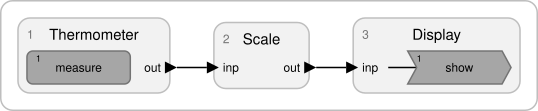

# Rust and Python in One App

One app can mix nodes written in Rust and nodes written in Python. Each node is a process of its own either way, so a Rust node can do the heavy work while Python nodes hold the rest together.

## Structure of a Mixed App

The graph of a mixed app is written in Python. A Rust node is a program of its own, and the Python app starts that program and connects it like any other node.

## The Rust Node

This node multiplies each reading it receives by a factor:

```rust title="core/examples/scale.rs"
use raio::app::{Builder, InputPort, OutputPort, Ports, create_node, run_node};
use raio::serializer::msgpack::MessagePackSerializer;
use raio::tasks;
use serde::{Deserialize, Serialize};
use std::rc::Rc;

/// A reading as a node in any language sees it: a map with these two entries.
#[derive(Serialize, Deserialize)]
struct Reading {
    name: String,
    value: f64,
}

#[derive(Ports)]
struct Scale {
    input: InputPort<Reading>,
    out: OutputPort<Reading>,
    factor: f64,
}

impl Scale {
    fn new(builder: &mut Builder, factor: f64) -> Self {
        Self {
            input: builder.input(),
            out: builder.output(),
            factor,
        }
    }

    async fn start(self: Rc<Self>) {
        while let Some((reading, _)) = self.input.wait().await {
            self.out.set(Reading {
                name: reading.name.clone(),
                value: reading.value * self.factor,
            });
        }
    }
}

/// Run only this node; a launcher starts the program and provides the rest of the app.
fn main() {
    let factor = std::env::args().nth(1).expect("usage: scale <factor>");
    let factor = factor.parse().expect("the factor is a number");
    let scale = create_node(|builder| Scale::new(builder, factor), tasks![Scale::start]);
    // With MessagePack the node's ports reach nodes written in Python as well.
    scale.input.set_serializer(MessagePackSerializer);
    scale.out.add_serializer(MessagePackSerializer);
    run_node(scale);
}
```

Two things set it apart from a node of a Rust app. First, `main` calls `create_node` and `run_node` in place of building an `App`: the program runs only this node, and a launcher provides the rest of the app. Second, the node puts `MessagePackSerializer` on its ports, so that nodes in other languages can read its values.

## The Python Declaration

In Python, the Rust node appears as a subclass of `RustNode`:

```python title="python/examples/scale.py"
import subprocess
from pathlib import Path

from raio import InputPort, OutputPort, RustNode

# A package that ships a Rust node carries its program; this one is raio-rs's `scale` example.
PROGRAM = Path(__file__).parents[2] / "target" / "debug" / "examples" / "scale"


class Scale(RustNode):
    """Multiplies the value of each reading by a factor; a reading is a name and a value."""

    inp = InputPort[dict]()
    out = OutputPort[dict]()

    def __init__(self, factor: float):
        self.factor = factor

    def start(self, node_id, coordinator_endpoint):
        # The factor is the program's own argument; the node's place in the app follows it.
        command = [str(PROGRAM), str(self.factor)]
        command += ["--node_id", str(node_id), "--coordinator_endpoint", coordinator_endpoint]
        return subprocess.Popen(command)
```

The class declares the node's ports, in the order in which the Rust node builds them. Its `start` method starts the program and returns the `subprocess.Popen`. Raio passes `start` the node's id and the endpoint of the coordinator, which the program takes as the arguments `--node_id` and `--coordinator_endpoint`.

## The App

The app connects the Rust node, `Scale`, between two Python nodes like any other:



```python title="python/examples/mixed.py"
import raio
from raio import MS, InputPort, Node, OutputPort, reaction, task
from scale import Scale


class Thermometer(Node):
    out = OutputPort[dict]()

    @task
    async def measure(self):
        for value in (20.5, 21.0):
            await raio.wait(1 * MS)
            self.out.set({"name": "celsius", "value": value})


class Display(Node):
    inp = InputPort[dict]()

    @reaction(inp)
    def show(self):
        print(f"{self.inp.value} at {self.inp.time}")


# The middle node is written in Rust; its connections to the Python nodes use MessagePack.
thermometer, scale, display = Thermometer(), Scale(10.0), Display()
raio.connect(thermometer.out, scale.inp)
raio.connect(scale.out, display.inp)
raio.run(thermometer, scale, display)
```

```console
$ cargo build --example scale
$ python python/examples/mixed.py
{'name': 'celsius', 'value': 205.0} at 1ms
{'name': 'celsius', 'value': 210.0} at 2ms
```

## Serialization

A connection between two Python nodes uses pickle, and one between two Rust nodes uses bincode. A connection between a Python node and a Rust node uses **MessagePack**, which Raio selects automatically. Its values are what both languages have: numbers, strings, lists, and maps. Above, a Python `dict` becomes the Rust struct `Reading` and back.
