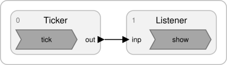

# Shutdown

<LanguageSelector />

There are four ways for an app to end:

- **Completion**: every node has finished its tasks.
- **Shutdown request**: a node asks the app to shut down.
- **Interrupt**: the user presses Ctrl-C.
- **Failure**: a node fails.

## Completion

A node finishes when all of its tasks have ended, and an app is over when every node has finished. The programs of the previous pages all end this way.

<Python>

A node that has a `shutdown` method runs it when it finishes on its own, too, at its last timestamp.

</Python>
<Rust>

A node that finishes on its own closes its output ports, and its receivers stop waiting for it.

</Rust>

## Shutdown Request

An app whose nodes run forever needs another way to stop. Below, `Ticker` never ends on its own, and requests a shutdown once it has sent its third value.

<Python>

**`raio.request_shutdown()`** asks every node of the app to shut down at one timestamp. **`raio.request_shutdown_after(delay)`** does the same, `delay` later. A node that has a **`shutdown`** method runs it once, at that timestamp.

</Python>
<Rust>

**`node.request_shutdown()`** asks every node of the app to shut down at one timestamp. **`node.request_shutdown_after(delay)`** does the same, `delay` later. A node that has a method marked **`#[shutdown]`** runs it once, at that timestamp.

</Rust>



<Python>

```python title="shutdown.py" {14,17,27}
import raio
from raio import MS, InputPort, Node, OutputPort, reaction, task

class Ticker(Node):
    out = OutputPort[int]()

    @task
    async def tick(self):
        count = 0
        while True:
            await raio.wait(1 * MS)
            self.out.set(count)
            if count == 2:
                raio.request_shutdown()
            count += 1

    def shutdown(self):
        print(f"ticker shut down at {raio.now()}")

class Listener(Node):
    inp = InputPort[int]()

    @reaction(inp)
    def show(self):
        print(f"received {self.inp.value} at {raio.now()}")

    def shutdown(self):
        print(f"listener shut down at {raio.now()}")

ticker, listener = Ticker(), Listener()
raio.connect(ticker.out, listener.inp)
raio.run(ticker, listener)
```

</Python>
<Rust>

```rust title="src/main.rs" {26,32,62}
use raio::app::{App, Builder, InputPort, Node, OutputPort, Ports, node};
use raio::time::MS;

#[derive(Ports)]
struct Ticker {
    node: Node,
    out: OutputPort<i64>,
}

#[node]
impl Ticker {
    fn new(builder: &mut Builder) -> Self {
        Self {
            node: builder.node(),
            out: builder.output(),
        }
    }

    #[task]
    async fn tick(&self) {
        let mut count = 0;
        loop {
            self.node.wait(1 * MS).await;
            self.out.set(count);
            if count == 2 {
                self.node.request_shutdown();
            }
            count += 1;
        }
    }

    #[shutdown]
    fn shutdown(&self) {
        println!("ticker shut down at {}", self.node.now());
    }
}

#[derive(Ports)]
struct Listener {
    node: Node,
    inp: InputPort<i64>,
}

#[node]
impl Listener {
    fn new(builder: &mut Builder) -> Self {
        Self {
            node: builder.node(),
            inp: builder.input(),
        }
    }

    #[reaction(inp)]
    fn show(&self) {
        println!(
            "received {} at {}",
            *self.inp.get().unwrap(),
            self.node.now()
        );
    }

    #[shutdown]
    fn shutdown(&self) {
        println!("listener shut down at {}", self.node.now());
    }
}

fn main() {
    let mut app = App::new();
    let ticker = app.create_node(Ticker::new);
    let listener = app.create_node(Listener::new);
    app.connect(&ticker.out, &listener.inp);
    app.run();
}
```

</Rust>

<Python>

```console
$ python shutdown.py
received 0 at 1ms
received 1 at 2ms
received 2 at 3ms
ticker shut down at (3ms, 1)
listener shut down at (3ms, 1)
```

</Python>
<Rust>

```console
$ cargo run
received 0 at 1ms
received 1 at 2ms
received 2 at 3ms
ticker shut down at (3ms, 1)
listener shut down at (3ms, 1)
```

</Rust>

Both nodes shut down at `(3ms, 1)`. A timestamp is a time and a **microstep**, and `(3ms, 1)` is one microstep after `3ms`: the shutdown comes after everything else that happens at `3ms`, so the listener still receives the last value.

## Interrupt

When the user presses Ctrl-C, every node runs its shutdown method at once. The nodes then stop at different timestamps. A second Ctrl-C ends nodes that are still shutting down.

## Failure

A node fails when one of its tasks or reactions raises an error, or when its process dies. When a node fails, the coordinator shuts down the other nodes and reports the node that failed. A node also counts as failed if it is silent for five seconds: each node tells the coordinator twice a second that it is alive, and a node whose thread is blocked cannot.

<Python>

The other nodes run their `shutdown` methods; the node that failed does not. The error of the failed node is printed, and `raio.run` raises a `RuntimeError` that names it, such as `node 1 (Ticker) exited with status 1`.

</Python>
<Rust>

The other nodes run their shutdown functions; the node that failed does not.

</Rust>

So nothing in a node may block its thread for that long: not a task, a reaction, or its shutdown method. See [Actions](actions.md#why-a-thread) for where blocking work belongs.
