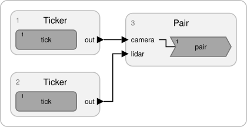

# Synchronizing Inputs

<LanguageSelector />

Robots combine data from several sources: a camera frame with a lidar scan, a command with a state estimate. In Raio, values that were sent at the same timestamp arrive at the same timestamp, so a node can combine them without buffers or matching by hand.

## Logical Simultaneity

Two values are **logically simultaneous** if they have the same timestamp. Below, a camera produces a value every second and a lidar every two seconds.

<Python>

The reaction of `Pair` is triggered by the camera. At each camera frame it checks **`lidar.present`**: whether a lidar scan arrived at the same timestamp.

</Python>
<Rust>

The reaction of `Pair` is triggered by the camera. At each camera frame it checks **`lidar.get()`**: whether a lidar scan arrived at the same timestamp.

</Rust>



<Python>

```python title="sync.py" {21,23}
import raio
from raio import InputPort, Node, OutputPort, S, Time, reaction, task

class Ticker(Node):
    out = OutputPort[int]()

    def __init__(self, period: Time, ticks: int):
        self.period = period
        self.ticks = ticks

    @task
    async def tick(self):
        for count in range(self.ticks):
            await raio.wait(self.period)
            self.out.set(count)

class Pair(Node):
    camera = InputPort[int]()
    lidar = InputPort[int]()

    @reaction(camera)
    def pair(self):
        if self.lidar.present:
            print(f"{raio.now()}: camera {self.camera.value} with lidar {self.lidar.value}")
        else:
            print(f"{raio.now()}: camera {self.camera.value} alone")

camera, lidar, pair = Ticker(1 * S, 4), Ticker(2 * S, 2), Pair()
raio.connect(camera.out, pair.camera)
raio.connect(lidar.out, pair.lidar)
raio.run(camera, lidar, pair)
```

</Python>
<Rust>

```rust title="src/main.rs" {50,52}
use raio::app::{App, Builder, InputPort, Node, OutputPort, Ports};
use raio::reaction;
use raio::tasks;
use raio::time::{S, Time};
use std::rc::Rc;

#[derive(Ports)]
struct Ticker {
    node: Node,
    out: OutputPort<i64>,
    period: Time,
    ticks: i64,
}

impl Ticker {
    fn new(builder: &mut Builder, period: Time, ticks: i64) -> Self {
        Self {
            node: builder.node(),
            out: builder.output(),
            period,
            ticks,
        }
    }

    async fn tick(self: Rc<Self>) {
        for count in 0..self.ticks {
            self.node.wait(self.period).await;
            self.out.set(count);
        }
    }
}

#[derive(Ports)]
struct Pair {
    node: Node,
    camera: InputPort<i64>,
    lidar: InputPort<i64>,
}

impl Pair {
    fn new(builder: &mut Builder) -> Self {
        Self {
            node: builder.node(),
            camera: builder.input(),
            lidar: builder.input(),
        }
    }

    async fn pair(self: Rc<Self>) {
        reaction!(self, [camera], {
            let camera = *self.camera.get().unwrap();
            match self.lidar.get() {
                Some(lidar) => {
                    println!("{}: camera {camera} with lidar {}", self.node.now(), *lidar)
                }
                None => println!("{}: camera {camera} alone", self.node.now()),
            }
        });
    }
}

fn main() {
    let mut app = App::new();
    let camera = app.create_node(
        |builder| Ticker::new(builder, 1 * S, 4),
        tasks![Ticker::tick],
    );
    let lidar = app.create_node(
        |builder| Ticker::new(builder, 2 * S, 2),
        tasks![Ticker::tick],
    );
    let pair = app.create_node(Pair::new, tasks![Pair::pair]);
    app.connect(&camera.out, &pair.camera);
    app.connect(&lidar.out, &pair.lidar);
    app.run();
}
```

</Rust>

<Python>

```console
$ python sync.py
1s: camera 0 alone
2s: camera 1 with lidar 0
3s: camera 2 alone
4s: camera 3 with lidar 1
```

</Python>
<Rust>

```console
$ cargo run
1s: camera 0 alone
2s: camera 1 with lidar 0
3s: camera 2 alone
4s: camera 3 with lidar 1
```

</Rust>

At `2s` and `4s` both sensors produce a value, and `Pair` handles the two together. `Pair` does not handle a timestamp until it knows what both of its senders sent at that timestamp. So it never sees the camera frame of `2s` without the lidar scan of `2s`, even if the lidar's process is slow to deliver it.

The pairing is therefore the same in every run, however long each process takes to produce its value.
