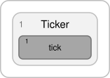
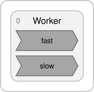

# Timers and Logical Time

<LanguageSelector />

## Logical Time

A key property of Raio is **logical time**. Every event of an app occurs at a **timestamp**, an instant in logical time. Logical time starts at zero when the app starts, and each node has its own logical clock.

By default, the runtime aligns logical time with **physical time**, the time of the wall clock: a node handles a timestamp no earlier than the wall clock reaches it. The **lag** is physical time minus logical time, and the runtime keeps it small and non-negative.

## Time Values

A time value is a number with a unit. The units are `NS`, `US`, `MS`, `S` (or `SECOND`), `MINUTE` and `HOUR`. The result is a `Time`, which is the type of both timestamps and durations.

<Python>

```python
from raio import MS, S

period = 20 * MS          # a Time
period * 5                # 100ms
(1 * S) // period         # 50, an int
(1 * S) / period          # 50.0, a float
```

</Python>
<Rust>

```rust
use raio::time::{MS, S};

let period = 20 * MS;                  // a Time
period * 5;                            // 100ms
(1 * S).nanos() / period.nanos();      // 50, an i64
```

</Rust>

## Timers

The simplest use of logical time is to do something periodically. Raio has no separate timer: a task waits for a duration of logical time, and a loop around that wait is a timer.

<Python>

In `Ticker` below, **`raio.wait`** suspends the task for one second of logical time and returns the new timestamp. The duration must be positive: `raio.wait(0 * S)` raises an error.

</Python>
<Rust>

In `Ticker` below, **`node.wait`** suspends the task for one second of logical time and returns the new timestamp.

</Rust>



<Python>

```python title="timer.py" {8}
import raio
from raio import Node, S, task

class Ticker(Node):
    @task
    async def tick(self):
        for count in range(3):
            now = await raio.wait(1 * S)
            print(f"tick {count} at {now}")

raio.run(Ticker())
```

</Python>
<Rust>

```rust title="src/main.rs" {20}
use raio::app::{App, Builder, Node, Ports};
use raio::tasks;
use raio::time::S;
use std::rc::Rc;

#[derive(Ports)]
struct Ticker {
    node: Node,
}

impl Ticker {
    fn new(builder: &mut Builder) -> Self {
        Self {
            node: builder.node(),
        }
    }

    async fn tick(self: Rc<Self>) {
        for count in 0..3 {
            let now = self.node.wait(1 * S).await;
            println!("tick {count} at {now}");
        }
    }
}

fn main() {
    let mut app = App::new();
    app.create_node(Ticker::new, tasks![Ticker::tick]);
    app.run();
}
```

</Rust>

<Python>

```console
$ python timer.py
tick 0 at 1s
tick 1 at 2s
tick 2 at 3s
```

</Python>
<Rust>

```console
$ cargo run
tick 0 at 1s
tick 1 at 2s
tick 2 at 3s
```

</Rust>

The lines appear at one second intervals. The timestamps are exactly `1s`, `2s` and `3s` in every run: a wait is measured from the node's current timestamp, not from the wall clock, so it does not depend on how long the task takes.

## Logical Time During Work

Logical time does not advance while a task runs. It advances only when the node moves to its next timestamp. Below, `Ticker` ticks every `200ms`, and each tick does `300ms` of work, more than the period.


<Python>

```python title="work.py" {10}
import time
import raio
from raio import MS, Node, task

class Ticker(Node):
    @task
    async def tick(self):
        for _ in range(3):
            now = await raio.wait(200 * MS)
            time.sleep(0.3)
            print(f"tick at {now}, still {raio.now()} after the work, lag {raio.physical_now() - raio.now()}")

raio.run(Ticker())
```

</Python>
<Rust>

```rust title="src/main.rs" {23}
use raio::app::{App, Builder, Node, Ports};
use raio::tasks;
use raio::time::MS;
use std::rc::Rc;
use std::thread;
use std::time::Duration;

#[derive(Ports)]
struct Ticker {
    node: Node,
}

impl Ticker {
    fn new(builder: &mut Builder) -> Self {
        Self {
            node: builder.node(),
        }
    }

    async fn tick(self: Rc<Self>) {
        for _ in 0..3 {
            let now = self.node.wait(200 * MS).await;
            thread::sleep(Duration::from_millis(300));
            let lag = self.node.physical_now() - self.node.now();
            println!(
                "tick at {now}, still {} after the work, lag {lag}",
                self.node.now()
            );
        }
    }
}

fn main() {
    let mut app = App::new();
    app.create_node(Ticker::new, tasks![Ticker::tick]);
    app.run();
}
```

</Rust>

<Python>

```console
$ python work.py
tick at 200ms, still 200ms after the work, lag 303711041ns
tick at 400ms, still 400ms after the work, lag 406661291ns
tick at 600ms, still 600ms after the work, lag 511997250ns
```

</Python>
<Rust>

```console
$ cargo run
tick at 200ms, still 200ms after the work, lag 305091208ns
tick at 400ms, still 400ms after the work, lag 406462542ns
tick at 600ms, still 600ms after the work, lag 511675167ns
```

</Rust>

After the work, the node's timestamp is still the one at which the tick began. The ticks keep their timestamps of `200ms`, `400ms` and `600ms`, although each arrives later than the last by the wall clock: the lag grows by about `100ms` per tick.

A node that is behind skips nothing. It handles every timestamp in turn, as fast as it can, and catches up once its work takes less time than its period.

## Comparing Logical and Physical Times

<Python>

**`raio.now()`** is the current timestamp of the node, and **`raio.physical_now()`** is the wall-clock time since the node started. Their difference is the lag, which `Ticker` below prints at every tick.

</Python>
<Rust>

**`node.now()`** is the current timestamp of the node, and **`node.physical_now()`** is the wall-clock time since the node started. Their difference is the lag, which `Ticker` below prints at every tick.

</Rust>


<Python>

```python title="lag.py" {9}
import raio
from raio import Node, S, task

class Ticker(Node):
    @task
    async def tick(self):
        for _ in range(3):
            await raio.wait(1 * S)
            lag = raio.physical_now() - raio.now()
            print(f"logical time {raio.now()}, lag {lag}")

raio.run(Ticker())
```

</Python>
<Rust>

```rust title="src/main.rs" {21}
use raio::app::{App, Builder, Node, Ports};
use raio::tasks;
use raio::time::S;
use std::rc::Rc;

#[derive(Ports)]
struct Ticker {
    node: Node,
}

impl Ticker {
    fn new(builder: &mut Builder) -> Self {
        Self {
            node: builder.node(),
        }
    }

    async fn tick(self: Rc<Self>) {
        for _ in 0..3 {
            self.node.wait(1 * S).await;
            let lag = self.node.physical_now() - self.node.now();
            println!("logical time {}, lag {lag}", self.node.now());
        }
    }
}

fn main() {
    let mut app = App::new();
    app.create_node(Ticker::new, tasks![Ticker::tick]);
    app.run();
}
```

</Rust>

<Python>

```console
$ python lag.py
logical time 1s, lag 1045709ns
logical time 2s, lag 683209ns
logical time 3s, lag 884375ns
```

</Python>
<Rust>

```console
$ cargo run
logical time 1s, lag 1229667ns
logical time 2s, lag 167417ns
logical time 3s, lag 1121792ns
```

</Rust>

Here the node keeps up, and the lag is about a millisecond. The amount of lag depends on the machine and on what else it is doing.

## Simultaneity

A node can have several tasks. They share the node's logical clock, and no two of them run at the same moment. When two tasks are due at the same timestamp, they run in the order in which they are declared. The node below has two tasks: `fast` prints every `500ms` and `slow` every second.



<Python>

```python title="two_tasks.py" {5,11}
import raio
from raio import MS, Node, S, task

class Worker(Node):
    @task
    async def fast(self):
        for count in range(4):
            await raio.wait(500 * MS)
            print(f"fast {count} at {raio.now()}")

    @task
    async def slow(self):
        for count in range(2):
            await raio.wait(1 * S)
            print(f"slow {count} at {raio.now()}")

raio.run(Worker())
```

</Python>
<Rust>

```rust title="src/main.rs" {35}
use raio::app::{App, Builder, Node, Ports};
use raio::tasks;
use raio::time::{MS, S};
use std::rc::Rc;

#[derive(Ports)]
struct Worker {
    node: Node,
}

impl Worker {
    fn new(builder: &mut Builder) -> Self {
        Self {
            node: builder.node(),
        }
    }

    async fn fast(self: Rc<Self>) {
        for count in 0..4 {
            self.node.wait(500 * MS).await;
            println!("fast {count} at {}", self.node.now());
        }
    }

    async fn slow(self: Rc<Self>) {
        for count in 0..2 {
            self.node.wait(1 * S).await;
            println!("slow {count} at {}", self.node.now());
        }
    }
}

fn main() {
    let mut app = App::new();
    app.create_node(Worker::new, tasks![Worker::fast, Worker::slow]);
    app.run();
}
```

</Rust>

<Python>

```console
$ python two_tasks.py
fast 0 at 500ms
fast 1 at 1s
slow 0 at 1s
fast 2 at 1500ms
fast 3 at 2s
slow 1 at 2s
```

</Python>
<Rust>

```console
$ cargo run
fast 0 at 500ms
fast 1 at 1s
slow 0 at 1s
fast 2 at 1500ms
fast 3 at 2s
slow 1 at 2s
```

</Rust>

At `1s` and `2s` both tasks are due. They are **logically simultaneous**, and `fast` runs first because it is declared first. The order of these lines is therefore the same in every run.

<Python>

## Fast-Forward

An app can also run without regard to physical time, as fast as it can. This suits tests and replays. To do so, pass **`fast_forward=True`**:

```python
raio.run(Ticker(), fast_forward=True)
```

The output is the same, timestamps included, but the lines appear at once.

</Python>
