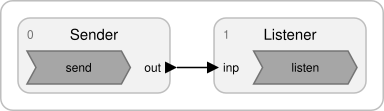
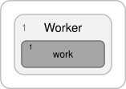

# Waiting on Several Things

<LanguageSelector />

A task often has to wait for more than one thing: a value or a time limit, or two values at once.

## The First of Several

<Python>

**`raio.select`** waits for the first of several things to finish and drops the others. Given names, it returns a dict with the one that finished.

</Python>
<Rust>

**`select`** of the `futures` crate waits for the first of two futures to finish and drops the other.

</Rust>

Below, `Sender` sends at `2s`. The listener waits twice: first for a value or one second, then for a value or five seconds.



<Python>

```python title="wait_first.py" {17,19}
import raio
from raio import InputPort, Node, OutputPort, S, task

class Sender(Node):
    out = OutputPort[str]()

    @task
    async def send(self):
        await raio.wait(2 * S)
        self.out.set("hello")

class Listener(Node):
    inp = InputPort[str]()

    @task
    async def listen(self):
        first = await raio.select(value=self.inp, tick=raio.wait(1 * S))
        print(f"{raio.now()}: {first}")
        first = await raio.select(value=self.inp, tick=raio.wait(5 * S))
        print(f"{raio.now()}: {first}")

sender, listener = Sender(), Listener()
raio.connect(sender.out, listener.inp)
raio.run(sender, listener)
```

</Python>
<Rust>

```rust title="src/main.rs" {44}
use futures::future::{Either, select};
use raio::app::{App, Builder, InputPort, Node, OutputPort, Ports};
use raio::tasks;
use raio::time::S;
use std::pin::pin;
use std::rc::Rc;

#[derive(Ports)]
struct Sender {
    node: Node,
    out: OutputPort<String>,
}

impl Sender {
    fn new(builder: &mut Builder) -> Self {
        Self {
            node: builder.node(),
            out: builder.output(),
        }
    }

    async fn send(self: Rc<Self>) {
        self.node.wait(2 * S).await;
        self.out.set("hello".to_string());
    }
}

#[derive(Ports)]
struct Listener {
    node: Node,
    inp: InputPort<String>,
}

impl Listener {
    fn new(builder: &mut Builder) -> Self {
        Self {
            node: builder.node(),
            inp: builder.input(),
        }
    }

    async fn listen(self: Rc<Self>) {
        for limit in [1 * S, 5 * S] {
            match select(self.inp.wait(), pin!(self.node.wait(limit))).await {
                Either::Left((value, _)) => {
                    println!("{}: value {}", self.node.now(), *value.unwrap().0)
                }
                Either::Right((now, _)) => println!("{now}: tick"),
            }
        }
    }
}

fn main() {
    let mut app = App::new();
    let sender = app.create_node(Sender::new, tasks![Sender::send]);
    let listener = app.create_node(Listener::new, tasks![Listener::listen]);
    app.connect(&sender.out, &listener.inp);
    app.run();
}
```

</Rust>

<Python>

```console
$ python wait_first.py
1s: {'tick': Time(1s)}
2s: {'value': 'hello'}
```

</Python>
<Rust>

```console
$ cargo run
1s: tick
2s: value hello
```

</Rust>

The first wait ends at `1s`, when the time has passed. The value was not lost by being dropped from the first wait: the second wait receives it at `2s`.

<Python>

If several of the things finish at the same timestamp, the dict has all of them. Without names, as in `raio.select(a, b)`, the dict is keyed by position: `{0: value}` if `a` finished.

</Python>
<Rust>

If both futures are ready at the same timestamp, `select` returns the first.

</Rust>

## Time Limits

<Python>

Waiting for a value with a limit is common enough to have its own function. **`raio.timeout`** awaits something and raises **`TimeoutError`** once a duration of logical time has passed. Below, the listener gives the value one second, and then five.

</Python>
<Rust>

A time limit is a `select` between the value and a wait. The method **`next_within`** below returns the next value, or `None` once a duration of logical time has passed. The listener gives the value one second, and then five.

</Rust>


<Python>

```python title="timeout.py" {18,21}
import raio
from raio import InputPort, Node, OutputPort, S, task

class Sender(Node):
    out = OutputPort[str]()

    @task
    async def send(self):
        await raio.wait(2 * S)
        self.out.set("hello")

class Listener(Node):
    inp = InputPort[str]()

    @task
    async def listen(self):
        try:
            await raio.timeout(1 * S, self.inp)
        except TimeoutError:
            print(f"{raio.now()}: nothing yet")
        value = await raio.timeout(5 * S, self.inp)
        print(f"{raio.now()}: {value}")

sender, listener = Sender(), Listener()
raio.connect(sender.out, listener.inp)
raio.run(sender, listener)
```

</Python>
<Rust>

```rust title="src/main.rs" {43}
use futures::future::{Either, select};
use raio::app::{App, Builder, InputPort, Node, OutputPort, Ports};
use raio::tasks;
use raio::time::{S, Time};
use std::pin::pin;
use std::rc::Rc;

#[derive(Ports)]
struct Sender {
    node: Node,
    out: OutputPort<String>,
}

impl Sender {
    fn new(builder: &mut Builder) -> Self {
        Self {
            node: builder.node(),
            out: builder.output(),
        }
    }

    async fn send(self: Rc<Self>) {
        self.node.wait(2 * S).await;
        self.out.set("hello".to_string());
    }
}

#[derive(Ports)]
struct Listener {
    node: Node,
    inp: InputPort<String>,
}

impl Listener {
    fn new(builder: &mut Builder) -> Self {
        Self {
            node: builder.node(),
            inp: builder.input(),
        }
    }

    async fn next_within(&self, limit: Time) -> Option<String> {
        match select(self.inp.wait(), pin!(self.node.wait(limit))).await {
            Either::Left((value, _)) => Some(value.unwrap().0.clone()),
            Either::Right(_) => None,
        }
    }

    async fn listen(self: Rc<Self>) {
        if self.next_within(1 * S).await.is_none() {
            println!("{}: nothing yet", self.node.now());
        }
        let value = self.next_within(5 * S).await.unwrap();
        println!("{}: {value}", self.node.now());
    }
}

fn main() {
    let mut app = App::new();
    let sender = app.create_node(Sender::new, tasks![Sender::send]);
    let listener = app.create_node(Listener::new, tasks![Listener::listen]);
    app.connect(&sender.out, &listener.inp);
    app.run();
}
```

</Rust>

<Python>

```console
$ python timeout.py
1s: nothing yet
2s: hello
```

</Python>
<Rust>

```console
$ cargo run
1s: nothing yet
2s: hello
```

</Rust>

The limit is in logical time, so the result does not depend on how fast the processes run: the first wait always times out at `1s`.

## All of Several, and Background Tasks

<Python>

**`raio.gather`** awaits several things at once and returns their results in order. **`raio.spawn`** starts a coroutine as another task of the node and returns at once, with a `Task` that tells whether it has finished. Below, a worker gathers steps `a` and `b`, then spawns step `c`.

</Python>
<Rust>

**`join!`** of the `futures` crate awaits several futures at once and returns their results in order. **`node.spawn`** starts a future as another task of the node and returns at once. Below, a worker joins steps `a` and `b`, then spawns step `c`.

</Rust>



<Python>

```python title="gather.py" {11-12}
import raio
from raio import Node, S, task

class Worker(Node):
    async def step(self, name: str, duration):
        await raio.wait(duration)
        return f"{name} done at {raio.now()}"

    @task
    async def work(self):
        print(await raio.gather(self.step("a", 2 * S), self.step("b", 1 * S)))
        background = raio.spawn(self.step("c", 1 * S))
        print(f"{raio.now()}: spawned, done: {background.done()}")
        await raio.wait(2 * S)
        print(f"{raio.now()}: done: {background.done()}")

raio.run(Worker())
```

</Python>
<Rust>

```rust title="src/main.rs" {27,30}
use futures::join;
use raio::app::{App, Builder, Node, Ports};
use raio::tasks;
use raio::time::{S, Time};
use std::rc::Rc;

#[derive(Ports)]
struct Worker {
    node: Node,
}

impl Worker {
    fn new(builder: &mut Builder) -> Self {
        Self {
            node: builder.node(),
        }
    }

    async fn step(self: Rc<Self>, name: &str, duration: Time) -> String {
        self.node.wait(duration).await;
        format!("{name} done at {}", self.node.now())
    }

    async fn work(self: Rc<Self>) {
        println!(
            "{:?}",
            join!(self.clone().step("a", 2 * S), self.clone().step("b", 1 * S))
        );
        let worker = self.clone();
        self.node.spawn(async move {
            println!("{}", worker.step("c", 1 * S).await);
        });
        println!("{}: spawned", self.node.now());
        self.node.wait(2 * S).await;
        println!("{}: done", self.node.now());
    }
}

fn main() {
    let mut app = App::new();
    app.create_node(Worker::new, tasks![Worker::work]);
    app.run();
}
```

</Rust>

<Python>

```console
$ python gather.py
('a done at 2s', 'b done at 1s')
2s: spawned, done: False
4s: done: True
```

</Python>
<Rust>

```console
$ cargo run
("a done at 2s", "b done at 1s")
2s: spawned
c done at 3s
4s: done
```

</Rust>

Steps `a` and `b` run together, so both are done by `2s`, not `3s`. Step `c` runs in the background while the task carries on.

<Python>

A spawned task starts when the task that spawned it next waits, at the same timestamp. A node finishes only when its spawned tasks have ended too.

</Python>
<Rust>

A spawned task starts when the task that spawned it next waits, at the same timestamp.

</Rust>
